# Starfleet Command

Starfleet Command is the control platform for a small home AI infrastructure. At its
core is a two-node NVIDIA DGX Spark cluster that serves language models, embedding
models and rerankers behind one OpenAI-compatible endpoint,
[llama-swap](https://github.com/mostlygeek/llama-swap), and image and video models
through ComfyUI, whose container llama-swap starts. You decide which models stay
resident, on which machine, at what context size and with what thinking effort, and
the cluster tooling behind it **refuses a load the machine cannot hold** instead of
letting it OOM.

Around the models sit the parts that make two machines with ~121 GiB each usable as
one service: tensor parallelism across both nodes, a key gate so that only a person
loads models, a memory guard that does admission control before every load, per-model
context budgets, and Red Alert and Auto Destruct for when everything has to stop.

You drive it from **Fleet**, a web control surface on the head node that the macOS app
opens as a window and the iPhone app opens on the phone. Fleet has views for the
models, the containers on both nodes (*Main Engineering*), the Synology NAS containers
(*Deep Space NAS*), the off-site backup (*Memory Alpha*) and the web server
(*Defiant*). *Computer* is a chat with the model that is already resident, with your
wiki and web search as tools and voice input transcribed on the Sparks, and *Memory
Core* draws the wiki as a map with the course Computer took through it. The Mac app
also keeps a menu bar glyph and a floating desktop widget, and can drive an optional
USB panel on the desk.
The two nodes are **Jean-Luc** and **Kathryn**, so the fleet is Starfleet.

<p align="center">
  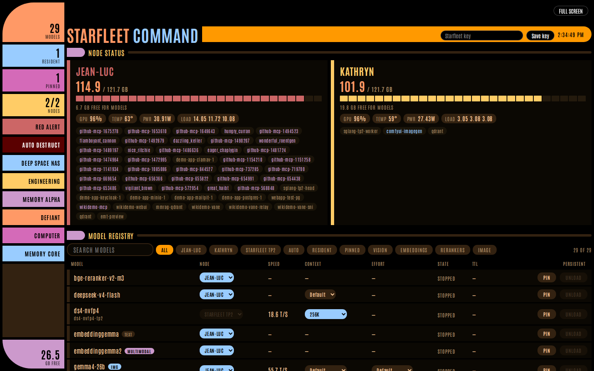
  <br><sub><b>Fleet</b>, the control surface: per-node status above, the model registry below. Names of private projects are replaced in the screenshots.</sub>
</p>

---

## Architecture

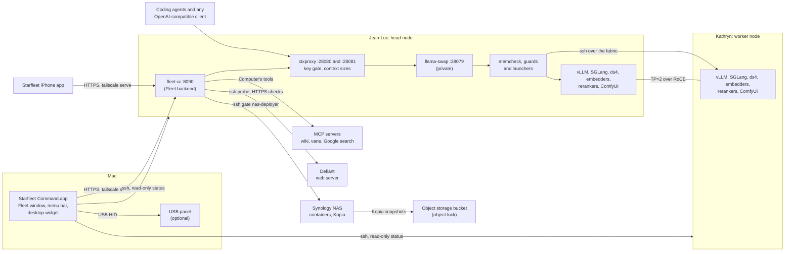

| Part | Runs on | Role |
| --- | --- | --- |
| **Starfleet Command.app** | Mac | Opens Fleet as a window, with a global hotkey for Computer's voice input; menu bar glyph, desktop widget and the optional USB panel; polls both nodes read-only over ssh. |
| **Starfleet iPhone app** | iPhone | The same page on the phone, over the tailnet; pull down to reload. |
| **Fleet** (`fleet-ui`) | Jean-Luc, `:8090` | The control surface: model registry, image and video models, Main Engineering, Deep Space NAS, Memory Alpha, Defiant, Computer, Memory Core, Red Alert and Auto Destruct. Drives llama-swap through ctxproxy. |
| **ctxproxy** | Jean-Luc, `:28080` and `:28081` | The only client that holds llama-swap's internal key. Refuses every load and unload without the Starfleet key, and lets any client ask for a context size. |
| **llama-swap** | Jean-Luc, `:28079` (private) | One OpenAI-compatible endpoint for all 46 members; starts and stops model servers on demand. |
| **memcheck and the other guards** | both nodes | Admission control before every load, and the timers that clean up after a broken one. |
| **Model servers** | both nodes | vLLM (single-node, or Ray clusters across both nodes for TP=2), SGLang (TP=2 clusters only), the antirez ds4 engine for the single-node DeepSeek-V4-Flash members, embedders and rerankers on vLLM's pooling runner, ComfyUI for images and video. |
| **Synology NAS** | the NAS | Its containers, reached through a gated ssh alias; Kopia snapshots the NAS into an object storage bucket with object lock. |
| **Defiant** | the web server | Hosts the public sites (Caddy with Let's Encrypt); Fleet probes it over ssh and checks every site over HTTPS. |

Everything that talks to a model, the coding agents, Starfleet Command and any
OpenAI-compatible client, talks to **one endpoint on the head node** and never thinks
about placement.

---

## What it does

- **Serves many models from one endpoint.** 46 llama-swap members: 27 language models
  (13 of them tensor-parallel across both Sparks), 12 embedders, 6 rerankers and the
  ComfyUI backend, plus 12 image and video models that Fleet manages inside ComfyUI.
  → [What the fleet serves](#what-the-fleet-serves)
- **Manages the models.** Search the catalogue, pin a model so it stays resident,
  choose which machine it runs on, set its context size and thinking effort, watch a
  load's progress and cancel it, queue the light loads, and, when everything has to
  stop, call a Red Alert.
  → [Fleet](#fleet-managing-the-models-from-a-window)
- **Keeps loading in human hands.** A key gate in front of llama-swap refuses every
  load and unload that does not carry the Starfleet key, so loading is something a
  person does at the Fleet window, not something an agent does on its own.
  → [The Starfleet key](#the-starfleet-key)
- **Protects the machines.** Every load goes through a memory check that knows what
  is free *and* what is already promised to a running image or video job, refuses to
  start on top of a cluster that looks orphaned, and refuses cleanly rather than
  OOMing.
  → [The memory guard](#the-memory-guard-admission-control-before-every-load)
- **Budgets context.** A context size per model, set without editing the config, a
  measured **Max** per model, and per-request sizes for any client.
  → [Context is its own budget](#context-is-its-own-budget)
- **Uses both nodes as one where it pays.** Tensor parallelism (TP=2) for models that
  do not fit one Spark or that serve many concurrent requests, a single node where
  that measured faster.
  → [Why tensor parallelism matters here](#why-tensor-parallelism-matters-here)
- **Shows what holds the memory.** *Main Engineering* lists every running container on
  both nodes with its RAM and GPU memory, when it started, what launched it and how
  long it has been idle, and stops the ones you no longer need.
  → [Main Engineering](#main-engineering-every-container-on-both-nodes)
- **Looks after the NAS.** *Deep Space NAS* shows the Synology's containers and
  hardware, with start, stop and restart. → [Deep Space NAS](#deep-space-nas-the-nas-containers)
- **Watches the off-site backup and the web server.** *Memory Alpha* shows the last
  backup snapshot, its size, the schedule and the object-lock renewal, with a **Back up
  now** button; *Defiant* shows the web server's health, its sites and certificates.
  → [Memory Alpha](#memory-alpha-the-off-site-backup) · [Defiant](#defiant-the-web-server)
- **Answers from your own knowledge.** *Computer* chats with the model that is already
  resident (it never loads one), with your wiki, vane and Google search as tools, image
  attachments for vision models, and voice input transcribed on the Sparks; *Memory
  Core* draws the wiki as one map with the course Computer took through it.
  → [Computer](#computer-a-chat-with-the-resident-model) ·
  [Memory Core](#memory-core-the-wiki-as-a-map)
- **Goes with you.** The Mac app and an iPhone app open Fleet over HTTPS on the tailnet;
  a phone gets an interface of its own, and on the Mac `⌃⌥C` opens Computer and starts
  voice input from any app.
  → [On the Mac and on the iPhone](#on-the-mac-and-on-the-iphone) ·
  [The phone interface](#the-phone-interface)
- **Stops everything on request.** Red Alert frees both Sparks; Auto Destruct does that
  and then reboots them. → [Red Alert and Auto Destruct](#red-alert-and-auto-destruct)
- **Keeps the configuration honest.** The cluster's llama-swap config, launchers and
  guards live in this repo (`cluster/`), with a sync tool that compares them with the
  nodes before it overwrites anything. → [Cluster tooling](#cluster-tooling) ·
  [Repo layout](#repo-layout)
- **Watches the cluster from the Mac.** GPU load, temperature, power and memory per
  node, which models are resident, and which coding-agent sessions are running, in the
  menu bar and on a desktop widget, with a notification when a session stalls.
  → [Watching the cluster](#watching-the-cluster)
- **Add-on: a USB panel for the desk.** A little LCARS readout, entirely optional.
  → [Add-on: the USB panel](#add-on-a-usb-panel-for-the-desk)

---

## The Starfleet cluster

Two **NVIDIA DGX Spark** nodes, each a GB10 with ~121 GiB of unified memory and
20 CPU cores, on the same LAN and reachable over Tailscale:

| Node | Role |
| --- | --- |
| **Jean-Luc** | Head node. Runs [llama-swap](https://github.com/mostlygeek/llama-swap), which fronts every model behind a single OpenAI-compatible endpoint, and Fleet. |
| **Kathryn** | Worker. Serves models of her own, pairs with Jean-Luc for tensor-parallel jobs, and runs the ComfyUI that new image and video models go to by default. |

The launchers, and Fleet's node probe, reach Kathryn over ssh at her ConnectX-7
fabric address, `10.100.0.1` (set in the launchers and in `NODES` in `fleet.py`), not
at her tailnet name: the bare tailnet name hits Tailscale SSH, which wants a browser and breaks
`BatchMode`.

### llama-swap holds the fleet together

**[llama-swap](https://github.com/mostlygeek/llama-swap)** (by
[mostlygeek](https://github.com/mostlygeek)) is the piece that makes a
two-machine fleet usable. It is a lightweight proxy that sits in front of your
inference servers and **swaps models in and out on demand**: a request names a
model, llama-swap starts whatever process serves it, proxies the request, and
unloads it again after an idle TTL.

That matters here because 46 members are defined but only ~121 GiB per node is
available. Without it you would be manually starting and stopping vLLM. With it,
everything (the coding agents, Starfleet Command, any OpenAI-compatible client)
talks to **one endpoint on the head node** and never thinks about placement.

One rule overrides load-on-request here: only a person with the Starfleet key may load
or unload a model. A client that names a model which is not resident gets a 403 instead
of a load ([The Starfleet key](#the-starfleet-key)).

Three features do the heavy lifting for a cluster:

- **Groups with swap/exclusive semantics.** Small models are marked to
  co-reside; a huge one is exclusive and evicts everything else on load. Crucially,
  Kathryn's pool is `exclusive: false`: loading a model on *her* machine frees
  nothing on *his*, so the two pools must never evict each other. Getting that
  wrong is how you end up with a node thrashing.
- **Arbitrary launch commands.** A "model" is just a command line, so a member
  can be a local vLLM, an SSH into Kathryn that starts a server there and tunnels
  the port back, or a Ray cluster spanning both Sparks for TP=2. All three look
  identical to the client.
- **Health checks and TTLs.** `checkEndpoint` gates readiness (a big model can
  take minutes to load), and `ttl` reclaims memory from idle models automatically.

`/running` on the head node reports what is currently resident, which is exactly
what the menu bar's "Serving:" line reads.

Models are named for what they are and where they run:

```
gemma4-26b-54tps-jean-luc       pinned to the head node
gemma4-26b-57tps-kathryn        pinned to the worker
gemma4-26b-56tps-fastest-node   whichever Spark has the most free memory right now
gemma4-31b-19tps-starfleet      tensor-parallel across BOTH
```

Where an id carries a tok/s figure, it is the measured single-stream throughput of that
exact configuration, so the faster option shows in the name. Not every id has one. For
most TP=2 members (the Ornith, GLM, Qwen3.8-Flash-Next, Qwen3.5-122B and Nemotron-120B
members and `ds4-nvfp4-tp2`) Fleet's Speed column takes the figure from a
measured-figures file instead ([How the registry gets its
numbers](#how-the-registry-gets-its-numbers)). The four vision members (two TP=2, two
single-node Qwen3.8-27B) and the two single-node DeepSeek-V4-Flash members have a
figure in neither place and show no speed.

### What the fleet serves

| Kind | llama-swap members | Notes |
| --- | --- | --- |
| Language models | 27 | 13 TP=2 members across both Sparks and 14 single-node members |
| Embedders | 12 | six models, each with a Kathryn twin |
| Rerankers | 6 | three models, each with a Kathryn twin |
| Image and video backend | 1 | `imagegen`, the ComfyUI container |

On top of the 46 members, Fleet lists 12 ComfyUI models that are not llama-swap
members (6 image, 6 video), so `/api/state` carries 58 entries. With each
multi-machine model merged into one row, the registry shows 29 rows under All (the
rail's Models counter shows the same number) and the 12 image and video rows under
Image.

### Not every member is a chat model

Eighteen members never generate a token (nineteen if you count `imagegen`, which makes
images rather than tokens):

- **12 embedders**, six models each with a twin on Kathryn: `nomic-embed-text`,
  `embeddinggemma`, `embeddinggemma2`, `harrier-embed-0.6b`, `qwen3-embed-0.6b` and
  `qwen3-embed-4b`.
- **6 rerankers**: the `bge-reranker-v2-m3` cross-encoder and `qwen3-reranker-4b` and
  `qwen3-reranker-8b`, each with a twin.

All 18 are served by [`serve-embed.sh`](cluster/llama-swap/serve-embed.sh); the
Kathryn twins reach it through [`serve-kathryn-embed.sh`](cluster/llama-swap/serve-kathryn-embed.sh),
an ssh wrapper to her fabric address. 16 of them run on vLLM's pooling runner
(`--runner pooling`). `embeddinggemma2` and its twin are the exception: a multimodal
embedder (text, image, audio and video in one 768-dimensional space) for which vLLM
0.27.1 has no architecture, so `serve-embed.sh` runs
[`serve-mm-embed.py`](cluster/llama-swap/serve-mm-embed.py), a small OpenAI-compatible
`/v1/embeddings` server, inside the same vLLM image with a newer transformers overlaid.
Fleet badges each embedder **MULTIMODAL** or **TEXT**.

Every retrieval group sets `exclusive: false`: a retrieval call must never evict a
language model, and must never be evicted by one. Embedders and rerankers are separate
groups because retrieval usually wants one of each resident at the same time:

| Group | Members | `swap` | Effect |
| --- | --- | --- | --- |
| `embeddings` | the 10 smaller embedders | `false` | all co-resident |
| `embeddings-large` | `qwen3-embed-4b` and its twin | `true` | picking a machine moves it |
| `rerankers-bge` | `bge-reranker-v2-m3` and its twin | `true` | picking the other twin replaces the current one |
| `rerankers-qwen` | `qwen3-reranker-4b`, `qwen3-reranker-8b` and their twins | `true` | picking another member, such as Kathryn's twin or the 4b instead of the 8b, replaces the current one |

The rerankers are split once more, one group per family (BGE and Qwen), so that loading
a Qwen reranker does not evict the BGE one.

The twins are not redundancy. Jean-Luc's pool can be genuinely too full for a
1 GiB model while a TP=2 member occupies it: on 2026-09-23 `harrier-embed-0.6b`
died on the head node with *"No available memory for the cache blocks"* while
Qwen3.8-Flash-Next held the pool, and the Kathryn twin served the identical
request without complaint. `gpu-memory-utilization` is a fraction of the whole
pool, not of what is left in it, so a tiny model can still be squeezed out.
Having each embedder addressable on either node is what makes that survivable.

One naming note. Fleet has a filter per kind, and each is a single test against
the member id: `/embed/i` and `/rerank/i`. That only partitions cleanly because
no embedder id contains `rerank` and no reranker id contains `embed`, which is a
convention the member names have to keep rather than something the code can
enforce: `microsoft/harrier-oss-v1-0.6b` is wired as `harrier-embed-0.6b` for
exactly that reason. Choosing the name is free; teaching two filters a list of
exceptions is not.

### Image and video models

llama-swap sees exactly one member for image and video, `imagegen` (the ComfyUI
container), and cannot tell which model is loaded inside it. Fleet reads the
image-generation stack's own catalogue instead: the `presets.FLEET_MODELS` table of a
separate repo, found through `FLEET_IMAGEGEN_REPO` and re-read whenever the file
changes. Each image or video model gets its own row with its memory footprint and a
note:

| Kind | Models |
| --- | --- |
| Image (6) | `flux-krea`, `flux-krea-hd`, `flux-fill`, `flux-kontext`, `qwen-image-2512`, `qwen-image-2.1` |
| Video (6) | `wan22-ti2v-5b`, `wan22-ti2v-5b-i2v`, `wan22-t2v-14b-fp8`, `wan22-t2v-14b-bf16`, `wan22-vace-fp8`, `wan22-vace-bf16` |

Without that repo the rows are simply absent and Fleet still starts. The visual-QA
critic (kind `judge`) is left out.

- **Placement.** ComfyUI runs on both nodes, and each row has its own node placement;
  new models default to Kathryn (`FLEET_DEFAULT_IMAGE_NODE`). Picking a node in Fleet
  saves `~/.config/fleet-ui/image-nodes.json`, which the render pipeline reads too, so
  the same choice decides where renders actually run. Changing the node clears the
  model's "loaded" flag, because the weights are on the old node.
- **Warm-up.** ComfyUI has no "load model" call, so a warm-up is a 256 px, one-step
  render, and Fleet waits until ComfyUI's queue is empty. So far only `qwen-image-2.1`
  has a warm-up graph; the other 11 answer "no warm-up graph for X yet" and load on
  their next real render. A warm-up is a load: it needs the Starfleet key and goes
  through the light-load queue.
- **Unload.** ComfyUI's `/free` drops the weights without killing the container, and it
  clears every model on that node, so Fleet clears the flag for all of them.
- **Reach.** ComfyUI has no authentication, so Fleet reaches it only over the nodes'
  fabric addresses, never the LAN or the tailnet (`FLEET_COMFYUI_URL`).

The memory side is shared too: memcheck's reservation ledger and
[`render-guard.sh`](cluster/llama-swap/render-guard.sh) keep a language-model load and
a ComfyUI render from colliding ([More guards around the pool](#more-guards-around-the-pool)).

---

## Fleet: managing the models from a window

**Fleet** is the control surface, and the part of Starfleet Command that does the
work. It is **[`fleet-ui`](fleet-ui)**: a stdlib-only Python backend
(`fleet.py`, about 3,600 lines, plus `wikicore.py` for Memory Core) and one page
(`fleet.html`, about 1,900 lines, re-read on every request). It runs on the head node
and drives llama-swap through ctxproxy.

On the Mac, Fleet is a window inside the app (`FleetView.swift`, a `WKWebView`). It
opens on demand, with "Open Starfleet Command…" in the menu bar dropdown, rather than
at launch: the app is normally a menu-bar-only accessory process with no Dock icon, and
becomes a regular app (Dock icon, `⌘`-Tab entry) only while the Fleet window is open,
reverting the moment it closes. The title bar is hidden so the traffic lights sit over
the LCARS header, and a 52 pt strip along the top drags the window. **Reload Fleet**
(`⌘R`) in the app menu reloads the page. On first open the window asks for Fleet's
address (a "Where is Fleet?" card with **Connect**); when the page cannot be reached it
shows a "Can't reach Fleet" card with a Tailscale hint and a **Retry** button (`⌘R`).
The web view identifies itself as `Starfleet Command/1.0 (macOS)`. The iPhone app is
the same page in its own shell ([On the Mac and on the
iPhone](#on-the-mac-and-on-the-iphone)).

### What you can do in the model registry

- **Browse the whole catalogue**: search, and filter by node, Starfleet TP2, Auto,
  Resident, Pinned, Vision, Embeddings, Rerankers or Image (the Image filter also shows
  the video rows: it keeps everything that is not a language model), with each model's
  measured tok/s. Every filter is also an address hash (`#jean-luc`, `#kathryn`,
  `#starfleet`, `#dynamic`, `#live`, `#pinned`, `#vision`, `#embed`, `#rerank`,
  `#image`), so `#kathryn` opens straight on her models.
- **See one row per model.** A model deployed on several machines is one row: its name
  without node, TP2 or tok/s, with the real member id underneath, and the Speed shown is
  the average across its machines. Rows whose names would clash are not merged.
- **See each node**: RAM, GPU, temperature, power, load and running containers.
- **Pin** a model so it stays resident ([what that guarantees](#what-pin-actually-guarantees)).
- **Choose where a model runs.** A model deployed on more than one machine gets a
  Machine picker: Jean-Luc, Kathryn, or Auto (whichever Spark has the most free
  memory right now). Pin, context, effort and load all apply to the machine picked.
  TP=2 members span both nodes by definition, so there is nothing to pick: the node
  column is always a dropdown, and for them it shows a disabled "STARFLEET TP2"
  (a single-node model shows its one node, disabled).
- **Set the context size** per model. **Max** is the largest context the model can
  really serve, the smaller of the checkpoint's window and the KV pool measured on
  its first load, not merely what the checkpoint declares. The picker steps through
  Default, 8K to 256K and Max (N), plus any value set elsewhere, and its tooltip says
  which limit binds (KV pool, checkpoint or launcher cap). vLLM allocates the pool at
  startup, so a change is one cold reload away; there is no live resize. See
  [Context is its own budget](#context-is-its-own-budget).
- **Set thinking effort**, where the model offers it: only the options that
  checkpoint's chat template actually accepts are shown, and a model with no such
  control shows nothing to pick. It takes effect by evicting a resident model, which
  comes back with the new default on its next keyed Load (also when pinned).
- **Get asked first.** Changing effort or context on a resident model asks first and
  warns that it means a cold load of several minutes. Cancelling a load asks too, and
  says that the engine is killed where it stands, the model is unpinned so it is not
  reloaded straight away, and anything already loaded is discarded. While a context or
  effort dropdown has focus, the 3-second poll does not redraw the table under it.
- **Watch a load, and cancel it.** Progress is read from the engine's own log, the
  ETA is the median of that model's last five cold loads, and cancelling drops the
  pin too.
- **See how a member is started**: the vision flag reflects what it is *started*
  with, not what the checkpoint could do, and shows as an **IMG** or **IMG OFF** badge.
- **Run image and video models alongside the language models**: the ComfyUI image and
  video rows have their own node placement, warm-up and unload
  ([Image and video models](#image-and-video-models)).
- **Queue the light loads.** Embedders, rerankers and image models load one at a time,
  and only while no language-model load is in flight; a language-model load never
  waits. A waiting model shows `queued #N` with a Dequeue button, and a bar above the
  table lists the queue.
- **Unload, and know it worked.** Unload waits until llama-swap no longer lists the
  model, then reports how much RAM came back on Jean-Luc, where Fleet runs ("N MB RAM
  freed on this machine"); for a Kathryn member that is about 0. A model that is still
  loading is cancelled instead.
- **Stop everything.** Red Alert frees both Sparks; Auto Destruct does that and then
  reboots them. → [Red Alert and Auto Destruct](#red-alert-and-auto-destruct)

### How the registry gets its numbers

- **Speed.** From `~/.config/fleet-ui/tps.json` first (measured figures with optional
  source notes, re-read when the file changes), then from the `-NNtps-` in the member
  id. That file is how TP=2 members without a number in their id get a speed, for
  example Ornith 45.0, Qwen3.8-Flash-Next 48.9, GLM 22.3 and Nemotron 36.1 tok/s. The
  vision members and the single-node DeepSeek-V4-Flash members are in neither place and
  show no speed.
- **Max context.** Fleet runs each launcher once in its `DRYRUN` mode to learn its
  checkpoint, deployed context and multimodal flags. A pass every 120 seconds dry-runs
  only the members not resolved yet, and re-reads the KV pools and effort options every
  time. It only dry-runs a launcher that implements `DRYRUN`, never one that would
  ignore it and really launch. Delegating members (the Kathryn and Auto members) borrow the answer
  from their twin. Three things then move Max:
  - a RoPE scaling override in the launcher's arguments: its `max_position_embeddings`
    beats the checkpoint's, which is how the `-long` Qwen3.8-Flash-Next member gets
    524,288;
  - the KV pool measured on a load, parsed from the vLLM run logs and from the SGLang
    head container's log, cached in `~/.config/fleet-ui/ctx-pool.json`, which lifts Max
    on its own after a load;
  - a ceiling file, `~/.gb10/ctxmax/<member>`, which sets the largest context the
    picker may offer (`serve-sglang.sh` clamps to the same number).
- **Thinking effort.** Parsed from the chat template exactly as the template validates
  it: graded `reasoning_effort` values (Qwen3.8 low, medium and xhigh; GLM low and
  high), a binary `low_effort` (Nemotron), thinking on and off, and thinking budgets of
  256, 1024 and 4096 (Nemotron-Cascade). The choice is stored compactly in
  `~/.gb10/effort/<member>`. Because the parser only reads the template, some embedders
  and rerankers (`harrier-embed`, `qwen3-embed-0.6b`, `qwen3-reranker`) also offer
  "thinking on/off": their chat templates mention `enable_thinking`.
- **Vision.** On, off or none, from the launch arguments: `--limit-mm-per-prompt
  image:N`, or `language-model-only`, plus a vision tower in the checkpoint's
  `config.json`.
- **Load progress.** Read from the engine's own log, from where this load started:
  starting engine, loading weights (with the tqdm percentage), KV cache, CUDA graphs,
  warming up, ready. Fleet keeps the furthest phase reached, so SGLang re-running the
  phases for its draft model does not move the bar back.
- **ETA.** The median of the model's last five cold loads, kept in
  `~/.config/fleet-ui/load-times.json` (written atomically; a "load" under 5 seconds was
  really a ttl refresh and is not counted). The page redraws it every second: from 4 %
  progress it projects from the progress, before that it uses the median. It says
  "First recorded load" when there is no history and "Taking longer than usual" when
  the load overruns, and the bar stops at 99 % until the model answers. A stale error
  is cleared when a new load starts, and a cancelled load is not shown as a fault.
- **Unload.** Fleet evicts through llama-swap's per-model route,
  `POST /api/models/unload/<model>`, because plain `GET /unload` evicts every model
  (an incident on 2026-10-02). It then polls `/running` until the model is gone and
  reports the MB freed, measured on Jean-Luc.

### Tables, views and the rail

Every table sorts by any column: click a heading, click again to reverse, a third time
for the default order (numbers start with the biggest; the choice is kept in the
browser). The model registry's default order is alphabetical by model name.

Seven views share the window. The left rail switches between them: **Starfleet
Command** (the models), **Deep Space NAS**, **Engineering**, **Memory Alpha**,
**Defiant**, **Computer** and **Memory Core**. The address keeps the view (`#nas`,
`#ctr`, `#ma`, `#def`, `#comp`, `#wiki`), so a reload or a bookmark opens the same one. The rail also counts **Models**, **Resident**,
**Pinned**, **Nodes** (up) and **GB Free**, and holds the Red Alert and Auto Destruct
buttons.

| View | Refreshes every |
| --- | --- |
| Models | 3 seconds |
| Deep Space NAS, Engineering | 10 seconds |
| Memory Alpha, Defiant | 15 seconds |
| Computer, Memory Core | when opened (the server reuses Memory Core's wiki graph for 10 minutes) |

A red banner appears when llama-swap cannot be reached, and a counter at the end of the
filter bar shows how many rows the current filter shows ("x of y").

### Model registry API

All `POST` calls take the `X-Starfleet-Key` header ([The Starfleet key](#the-starfleet-key)).

| Call | Body | Does |
| --- | --- | --- |
| `GET /api/state` | | the registry snapshot the page polls: nodes, every model row (language, image and video), what is running, pins, the load queue, loads in flight, errors |
| `POST /api/pin` | `{"model": "...", "pin": true}` | pins; for a model that is not resident this is the keyed Load (there is no `/api/load`). `"pin": false` unpins and dequeues |
| `POST /api/effort` | `{"model": "...", "effort": "..."}` | sets the thinking effort (`null` goes back to the default); a resident model is evicted and comes back with it on its next keyed Load (also when pinned) |
| `POST /api/ctx` | `{"model": "...", "ctx": 32768}` | sets the context size, 256 to 1,048,576 (empty goes back to the deployed default); only for members wired through `ctx-env.sh`; a resident model is evicted and comes back at the new size on its next keyed Load (also when pinned) |
| `POST /api/unload` | `{"model": "..."}` | dequeues and unpins it, cancels a load still in flight, or evicts a resident model and returns `freed_mb` |
| `POST /api/cancel` | `{"model": "..."}` | cancels a load and dequeues it |
| `POST /api/imgnode` | `{"model": "...", "node": "kathryn", "warm": true}` | sets where an image or video model runs; with `warm` (the default) also queues a warm-up, which needs the key |
| `POST /api/imgunload` | `{"model": "..."}` | dequeues it, or frees ComfyUI on its node (every model there) |
| `GET /api/boot` | | the head node's kernel boot id, so the page can tell when Jean-Luc has rebooted |
| `GET /api/jobs` | | the GPU job queue ([Backend details](#backend-details-state-polling-and-self-check)) |

Fleet also serves `/ds9.jpg` and `/sounds/tng_red_alert1.mp3` when those files exist
next to `fleet.py`.

### Main Engineering: every container on both nodes

<p align="center">
  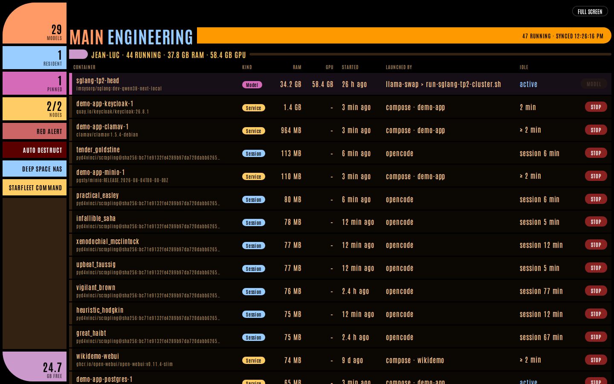
  <br><sub><b>Main Engineering</b>: what holds the memory, and who started it. Names of private projects are replaced in this screenshot.</sub>
</p>

A table per node of every running container, biggest first:

| Column | Where it comes from |
| --- | --- |
| **Kind** | *Model* (holds a GPU: vLLM, SGLang, embedders, ComfyUI), *Session* (an MCP server started by a coding-agent session) or *Service* (everything else) |
| **RAM** | the container's cgroup: `memory.current` minus `inactive_file`, the number `docker stats` shows |
| **GPU** | `nvidia-smi` memory of the container's processes, mapped through `/proc/<pid>/cgroup` |
| **Started** | `docker inspect` `State.StartedAt` |
| **Launched by** | the process tree: the `docker run` (or `docker logs -f`) client naming the container, walked up to the first of llama-swap, a Claude Code or opencode session, or a systemd unit; else the compose project or restart policy. A TP worker started over ssh inherits its head's launcher, marked "(worker)"; a client found on the other node is marked "(on &lt;node&gt;)" |
| **Idle** | for a session's container: how long that session has been inactive. Otherwise how long the container has used no CPU (under 1 % of a core between two probes). That clock starts with the Fleet service, so a container that has not moved since then shows `≥` |

A background thread probes both nodes every 30 seconds (one read-only shell script per
node, over ssh for Kathryn), so the idle clocks keep running while nobody has the view
open; the view itself refreshes every 10 seconds.

**Stop** runs `docker stop -t 10` on the container's node. It needs the Starfleet key and
a second click (the button turns into *Sure?* for four seconds). Model servers have no
Stop button here: stopping one behind llama-swap's back would leave it believing the
model is loaded, so those are unloaded in the model registry, and a pinned model can
never be stopped from this view. Containers started with `--rm` (most MCP servers) are
gone after a stop; the session that started one loses that tool until it restarts it.

| Call | Body | Does |
| --- | --- | --- |
| `GET /api/containers` | | every running container on every node, with `errors` per node that did not answer (its last list stays) |
| `POST /api/containers/stop` | `{"node": "kathryn", "name": "qdrant"}` | stops it; 403 without the key, 409 for a model server, 400 for a container that is not running there |

### Deep Space NAS: the NAS containers

<p align="center">
  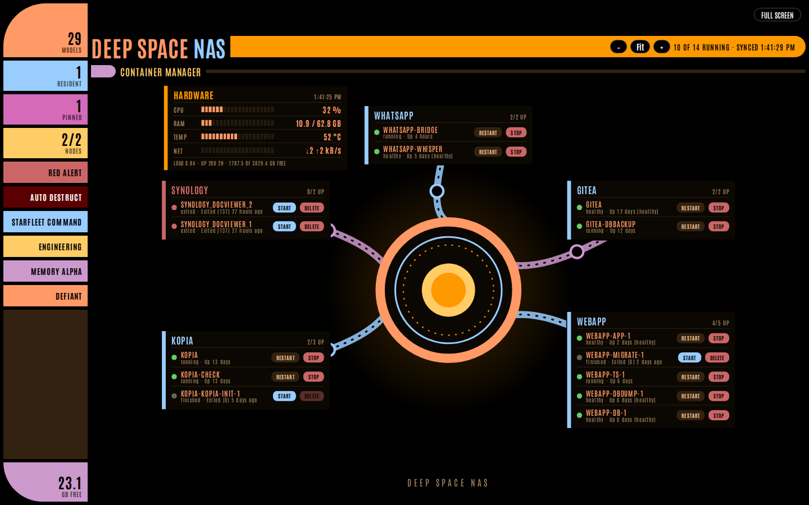
  <br><sub><b>Deep Space NAS</b>: the Synology's containers docked on the station's pylons.</sub>
</p>

The Synology's containers, grouped by compose project. The largest projects dock on the
roomiest pylons, pylons with nothing to show are not drawn, and from the seventh project
on the panels stand in columns to the left and right of the station, using the width of
a wide or full-screen window. Each container has Start, Stop and Restart (and Delete
once it has stopped), with a second click to confirm; a hardware panel shows the NAS's
CPU, RAM, hottest sensor and network rates. Zoom buttons (−, Fit, +) scale the station
from 0.4× to 3×, and the zoom is kept in the browser.

Fleet reaches the NAS through one ssh alias, `nas-deployer`, whose forced command on
the NAS (a small gate script, not part of this repo) answers `ps --all`, `stats`,
`control <container> <start|stop|restart>`, `rm <container>` and
`logs <container> --tail N` (which Memory Alpha reads) in JSON and owns the
policy: what may be touched, and which projects are frozen. NAS actions therefore do
not need the Starfleet key; the gate decides, and the page asks for the second click.
The station is drawn by the page; if `fleet-ui/ds9.jpg` exists next to `fleet.py` it is
used as the backdrop instead (a real photo is copyrighted, so `.gitignore` keeps it
out).

| Call | Body | Does |
| --- | --- | --- |
| `GET /api/nas` | | all NAS containers, running and stopped |
| `GET /api/nas/stats` | | the NAS's hardware figures |
| `POST /api/nas/control` | `{"target": "...", "action": "start\|stop\|restart\|rm"}` | asks the gate to do it |

### Memory Alpha: the off-site backup

<p align="center">
  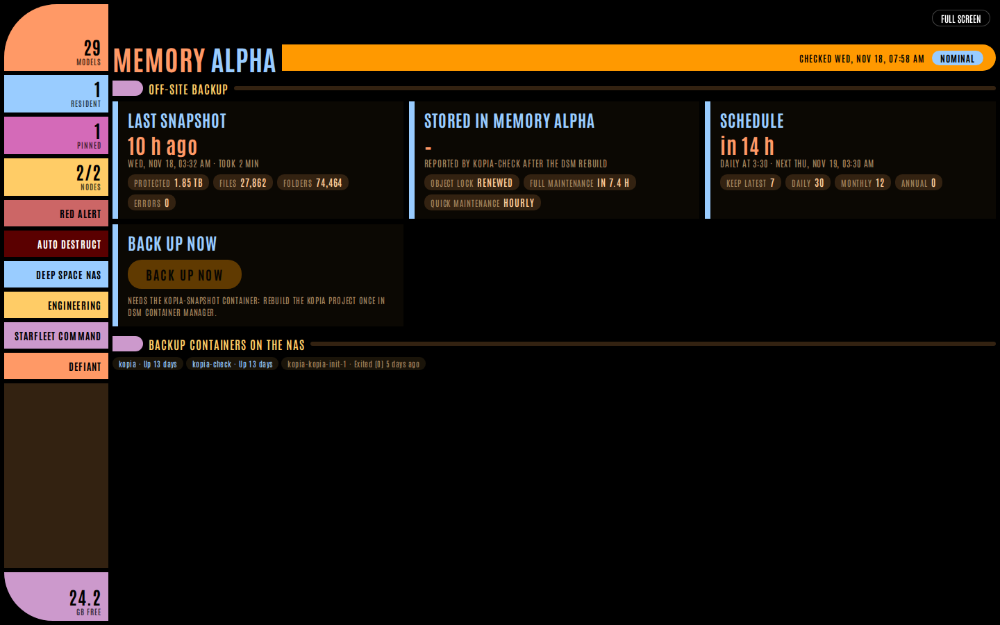
  <br><sub><b>Memory Alpha</b>: the off-site backup at a glance.</sub>
</p>

[Kopia](https://kopia.io) runs on the NAS and snapshots its volume into an object storage
bucket with object lock in compliance mode, so no snapshot can be deleted or altered
before its lock expires; full maintenance renews the locks daily. The view shows:

- **Last snapshot**: when it finished, how long it took, the protected size, file and
  folder counts and errors
- **Stored in the bucket**: bytes and blob count after deduplication and compression,
  plus whether lock renewal is on and when full maintenance runs next
- **Schedule and retention**: the daily snapshot time and the next run, and how many
  latest, daily, monthly and annual snapshots are kept
- **Status**: *Attention* when the last snapshot is older than 30 hours, incomplete or
  has errors, or when lock renewal stopped: renewal switched off, or full maintenance
  last ran over 48 hours ago (the same rules as the daily watchdog)

Fleet holds no backup credentials. It reads the status lines a `kopia-check` container
logs every six hours (`SNAP`, `MAINT`, `BLOB`), the policy printed by the init container
and the container states, all through the NAS gate's read-only verbs. **Back up now**
needs the Starfleet key and a second click; it starts a one-shot `kopia-snapshot`
container with the gate's `control start`, which takes a snapshot of the volume and logs
the result (`SNAPNOW`, `SNAPERR`, `EXIT`). The button stays disabled until that container
exists in the NAS's compose project.

| Call | Body | Does |
| --- | --- | --- |
| `GET /api/memoryalpha` | | last snapshot, stored bytes, maintenance, policy, next snapshot, manual run, problems |
| `POST /api/memoryalpha/backup` | `{}` | starts a snapshot; 403 without the key, 409 when the one-shot container is missing or already running |

### Defiant: the web server

<p align="center">
  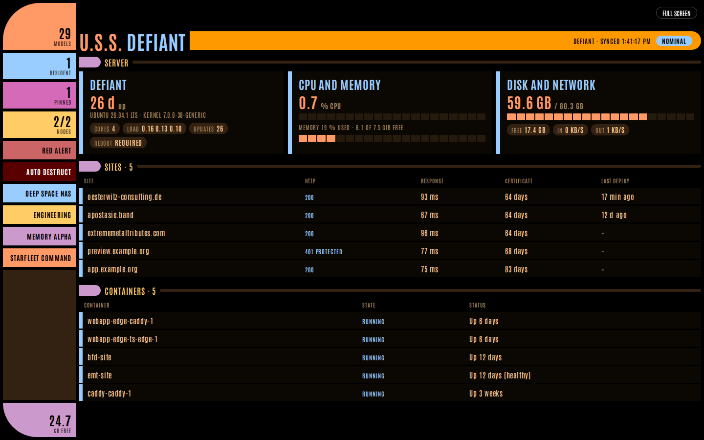
  <br><sub><b>Defiant</b>: the web server's health, sites and certificates. Two site names are replaced.</sub>
</p>

The web server that hosts the public sites (Caddy with Let's Encrypt). One read-only ssh
probe returns uptime, OS and kernel, load, CPU use and network rates over one second,
memory, disk, pending package updates, whether a reboot is required, the containers and
the site blocks of the Caddyfile. Fleet then checks every site over HTTPS itself: status
code, response time and days until the certificate expires (a 401 counts as a protected
site, not a fault). *Attention* means a site is down, a certificate expires within 14
days, the disk is over 85 % full or a container is not running.

The ssh target comes from the service environment, `FLEET_DEFIANT_HOST` (for example
`user@host` in a systemd drop-in), so no address lives in the code; without it the view
says it is not configured.

| Call | Body | Does |
| --- | --- | --- |
| `GET /api/defiant` | | host figures, sites with status, response time, certificate and last deploy, containers, problems |

### Computer: a chat with the resident model

A chat for knowledge work against a model that is **already resident**: Computer never
loads a model. Its model picker lists only the language models loaded right now (no
embedder, reranker or image stack), and its requests go to llama-swap through ctxproxy
*without* the Starfleet key, so even a race with an unload ends in the gate's 403, never
in a load. To chat with another model, load it in the registry first.

<p align="center">
  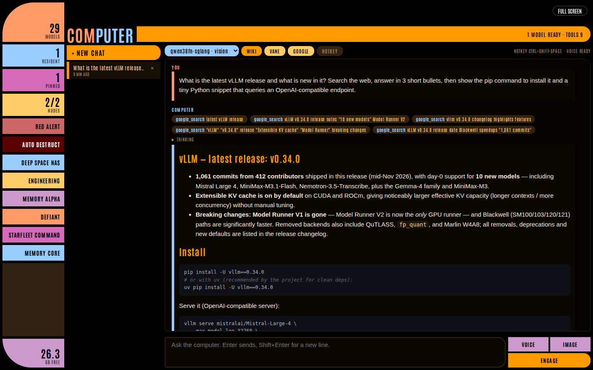
  <br><sub><b>Computer</b>: a web search answered by the resident model, with the tool calls shown as chips.</sub>
</p>

- **Tools** come from MCP (Model Context Protocol) servers, each switched on or off per
  message: **Wiki** (the read tools of a wiki MCP server: `wiki_overview`,
  `wiki_search`, `wiki_related` and `wiki_read`), **Vane** (`vane_search`,
  `vane_deep_research`) and **Google** search. A message gets up to 8 model and tool
  round trips, at most 4 tool calls per step and 20 minutes in total, and the model is
  checked to be still resident before every step. Wiki results carry links to
  `127.0.0.1`; `FLEET_WIKI_PUBLIC_URL` rewrites them to an address the browser can open.
  The MCP servers run with a minimal environment and load their own keys. `~/.config/fleet-ui/computer-mcp.json`, if present, replaces the
  built-in server list.
- **Private stays private.** Every argument of a web tool call (Vane, Google) passes a
  guard before it leaves the head node. It refuses a secret (a value of a key, token or
  password variable, or a known key format), a customer-specific term (a local block list
  in `~/.config/fleet-ui/web-guard.json`, plus the wiki's entity pages tagged
  `customer/*` that are people, organisations, projects or internal systems; public
  products are not blocked), personal data (email, phone number, IBAN) or pasted text
  (over 300 characters). A refused call sends nothing; the model is told why and has to
  search with generic terms. `"allow"` in the same file un-blocks a term.
- **Images.** Attach or paste up to four images; they reach the model only when it is
  started with vision.
- **Voice.** **Voice** records in the browser, converts the clip to 16 kHz mono WAV and
  sends it to the head node, which runs whisper.cpp on the Sparks through a
  memory-guarded speech-to-text gate script (`FLEET_ASR_GATE`, not part of this repo).
  It tries each node in turn and says so when both are too busy. The microphone needs a
  secure context, so voice works only over HTTPS ([On the Mac and on the
  iPhone](#on-the-mac-and-on-the-iphone)). A hotkey (Ctrl+Shift+Space by default, set
  with the **Hotkey** button) opens Computer and starts or stops the microphone while
  the page has focus.
- **Untrusted text is rendered safely.** Answers and tool results are markdown, rendered
  with marked and sanitised with DOMPurify (no styles, forms or embeds); code is
  highlighted with highlight.js. The three libraries are served from `fleet-ui/vendor/`,
  not a CDN. An image in an answer may only come from Fleet itself or a `data:` URL: an
  image from any other host could carry chat or wiki text out in its URL, so it is shown
  as a link instead. The page also sends a Content-Security-Policy (`img-src 'self'
  data: blob:`, `connect-src 'self'`, `form-action 'none'`) as a second line.
- **Chats stay on the head node**, one JSON file each in
  `~/.local/share/fleet-ui/computer/` (`FLEET_COMPUTER_DIR`), listed on the left of the
  view. Answers stream in, and the model's reasoning is kept with each one.

Every `/api/computer` call needs the Starfleet key, and the check fails closed: Fleet asks
ctxproxy's `GET /starfleet/check`, which ctxproxy answers itself, before its guard and
without llama-swap: 204 for the Starfleet key, 403 for anything else. Fleet accepts only a
204; a 403, an error or no answer all reject, and nothing is cached, so a rotated key takes
effect at once. Without
the key the request body is never read. A chat answers one message at a time, and it is
saved even when an answer fails or the browser goes away.

| Call | Body | Does |
| --- | --- | --- |
| `GET /api/computer/models` | | the resident chat models with their vision flag, and each tool server with its tools and any error |
| `GET /api/computer/chats` | | the saved chats |
| `GET /api/computer/chat?id=...` | | one chat |
| `POST /api/computer/send` | `{"model": "...", "text": "...", "images": [...], "tools": [...], "id": "..."}` | sends one message (no `id` starts a new chat); the answer streams back as server-sent events: tokens, reasoning, tool calls and results; a model that is not loaded answers with an error event, never a load |
| `POST /api/computer/delete` | `{"id": "..."}` | deletes a chat |
| `POST /api/computer/transcribe` | a WAV file | speech to text: `text`, `language` and the `node` that did it; 409 when both Sparks are busy |

### Memory Core: the wiki as a map

<p align="center">
  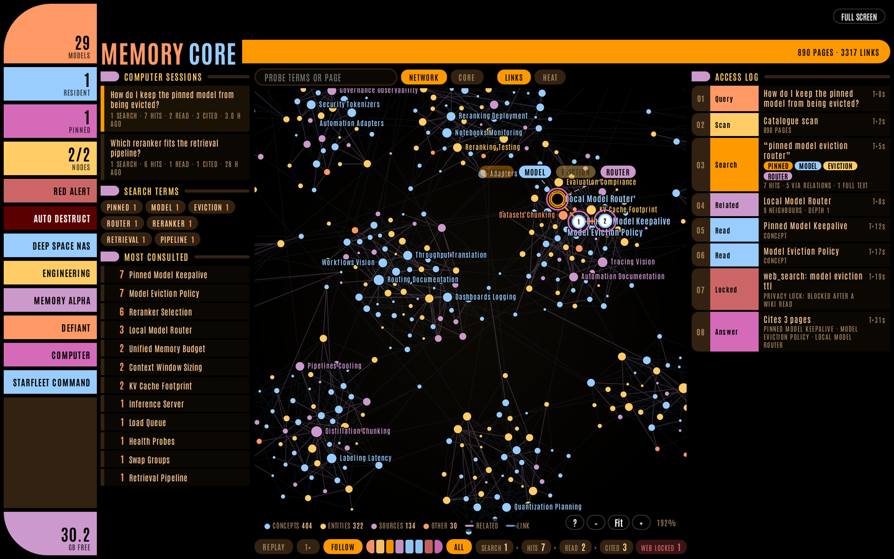
  <br><sub><b>Memory Core</b>: the wiki as a zoomable network; a Computer session as search terms, hits, numbered reads and cited pages, with the access log and the replay bar. Example data from a generated wiki.</sub>
</p>

Memory Core draws the LLM wiki as a map you can zoom and move: every page is a dot
(colour = page type, size = inbound link weight), every wiki link a line (colour =
relation). In the **Network** layout a force simulation pulls linked pages together, so
clusters are topics; it settles once and the browser keeps it, so pages stay where they
were. The **Core** layout is the ship's memory core: one ring per page type (other,
concepts, entities, sources, from the centre out). Wheel, pinch or the buttons zoom and
dragging moves the map. The overview stays quiet: it draws the related links and a few
page names, and the plain links and more names appear as you zoom in. Until a Computer
chat has used the wiki, the side panels and the replay bar stay hidden.

- **Connections.** Hover a page for its links, click it for its neighbourhood,
  double-click to zoom to it, Shift-click a second page (or **Path to…**) for the
  shortest chain of links between the two.
- **Open.** The page card's **Open** button shows that page's markdown in a panel over
  the map, with the frontmatter folded into "Properties". Wiki links in the text select
  the linked page, and the open panel follows the selection. Esc closes it.
- **Term probe.** Type terms: each becomes a pill wired to the pages whose title, tags
  or summary contain it. Pages that several terms share are the bridges between them.
- **Computer.** A chat that used the wiki is drawn as a summary: its search terms, the
  pages they matched, the pages read (numbered) and the pages the answer cited. Hover a
  step or replay the chat for the full picture of a search: term pills to the pages they
  matched, dashed lines to pages reached over a relation, dotted lines to full-text
  hits. The bar under the map replays it step by step with the camera following, and
  counts searches, hits, reads and cited pages. A web search refused after a wiki read
  shows as **Locked**.
  The newest chat is shown by default. **Clear** in the session list, or a second tap
  on the shown chat, takes it off the map; the map then shows only the wiki, also after
  a reload, until you pick a chat again.

It is read-only. [`wikicore.py`](fleet-ui) exports the graph with the wiki MCP server's
own link scanner, run with that server's Python (`FLEET_MEMORY_CORE`, default
`~/memory-core`), so the map shows exactly the relations Computer's `wiki_search` and
`wiki_related` follow; an export is reused for 10 minutes. The export only reads the
vault, so the map also works while the server is stopped, and the last good map is
kept on disk. The courses come from Computer's chat files.
Both calls need the Starfleet key, like the rest of Computer.

| Call | Body | Does |
| --- | --- | --- |
| `GET /api/computer/wiki/graph` | | the wiki's pages and links |
| `GET /api/computer/wiki/trails` | | every wiki call of the recent Computer chats, with what it returned and what the answer cited |
| `GET /api/computer/wiki/page?p=wiki/….md` | | one page's markdown, read from disk; only `.md` files inside the wiki folder (`FLEET_WIKI_ROOT`, default `~/llm-wiki`) |

### Full screen

<p align="center">
  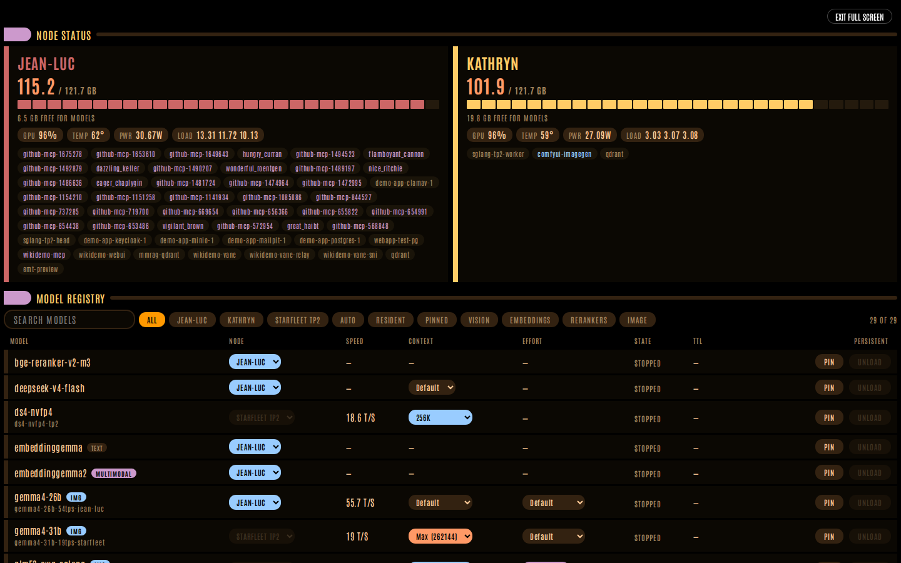
  <br><sub>Full screen: the rail and header give their space to the view.</sub>
</p>

The **Full screen** button in the top-right corner, or the `F` key (ignored while you
type in a field), puts the window into the browser's own full screen
(`requestFullscreen`, with the `webkit` prefix for older Safari). The left rail, the
header bar and the scrollbars are hidden so the current view fills the display, and the
table's column headings stay at the top while it scrolls. `Esc` or the button leaves.
Where a browser refuses or ignores the request, the same layout fills the window
instead. The app's `WKWebView` allows element full screen
(`isElementFullscreenEnabled`, macOS 12.3 and later).

### On the Mac and on the iPhone

Both apps are thin shells around the same page: Fleet's address is the only thing they
store (UserDefaults, asked for on first open), and the Starfleet key stays in the
page's own `localStorage`, as in a browser.

- **Over HTTPS.** Point them at the address `tailscale serve` publishes Fleet on,
  `https://<head-node>.<tailnet>.ts.net:<port>`. The page gets the microphone only in a
  secure context; the Mac window still loads a plain `http://` address, without voice.
- **Microphone.** The web views grant the microphone to Fleet's own origin and nothing
  else; macOS and iOS ask once (`NSMicrophoneUsageDescription`).
- **Dialogs.** The page's `alert()` and `confirm()` show as native alerts. Before, the
  Mac window dropped them and answered every `confirm()` with Cancel.
- **`⌃⌥C` on the Mac**, from any app: brings the Fleet window to the front, opens the
  [Computer](#computer-a-chat-with-the-resident-model) view and starts voice input
  (press again to stop), the same as the page's own hotkey (Ctrl+Shift+Space by
  default), which only works while the window has focus. A global hotkey through
  Carbon's `RegisterEventHotKey`, so no Accessibility permission.
- **Help and About.** **Help** in the dropdown (or the Help menu, `⌘?`, while the Fleet
  window is open) opens a short guide: the menu bar icon, the shortcuts, Fleet's
  address, updates and what to do when something is wrong. **About** shows the build's
  commit and the credits.
- **iPhone:** pull down to refresh; when Fleet can't be reached (Tailscale off, head node
  down) an error card with Retry, and coming back from the Tailscale app retries by
  itself. A phone is served [its own interface](#the-phone-interface), not the desktop
  page.

### The phone interface

<p align="center">
  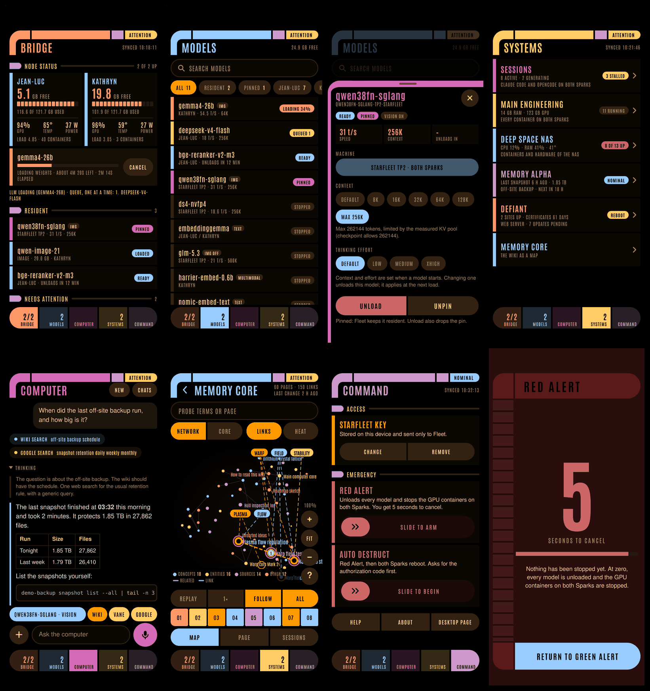
  <br><sub>Bridge, Models, a model's sheet, Systems, Computer, Memory Core, Command and an armed Red Alert (generated test data).</sub>
</p>

The desktop page does not shrink well to a phone, so a phone gets an interface of its own:
[`fleet-ui/padd.html`](fleet-ui/padd.html) with `vendor/padd.css` and `vendor/padd*.js`
(PADD, after the handheld). Same LCARS colours and type as the desktop page, different
shapes: a header with an elbow, a tab bar in the rail's colours, bottom sheets where the
desktop has dialogs, and every touch target at least 44 pixels.

`fleet.py` serves it at `/` to an iPhone or an Android phone and at `/padd` to anyone.
The desktop page stays at `/desktop`; an iPad and the Mac app keep getting it at `/`.
`touch fleet-ui/padd.off` hands phones the desktop page again without a restart. Because
Fleet serves the interface, an update reaches the phone with a pull down to refresh, not
an app update.

| Tab | What it is for |
| --- | --- |
| **Bridge** | The status word in the header (Nominal, Attention, Fault, Sync lost; tap it for the reasons), both nodes with free memory first, loads in progress with Cancel, the queue, the resident models and what needs attention |
| **Models** | Search and filter chips over every model; a tap opens a sheet with Load and pin, Unload, Cancel, machine, context and thinking effort, and for image and video models machine, Load and Unload |
| **Computer** | The chat with the resident model, voice first: a large microphone button, tool switches and image attachments, with the chat list and the model choice in sheets |
| **Systems** | Sessions, [Main Engineering](#main-engineering-every-container-on-both-nodes), [Deep Space NAS](#deep-space-nas-the-nas-containers), [Memory Alpha](#memory-alpha-the-off-site-backup), [Defiant](#defiant-the-web-server) and [Memory Core](#memory-core-the-wiki-as-a-map) |
| **Command** | The Starfleet key, Red Alert, Auto Destruct, Help and About |

What works differently from the desktop page:

- **Sheets, not dialogs.** Every confirmation is a sheet whose confirming button sits at
  the bottom, in thumb reach. A confirmation ignores taps in its first moments, so a double
  tap cannot confirm it.
- **The key is asked for when an action needs it**, in a sheet, and the action goes ahead
  once it is accepted. It is kept in the page's `localStorage` like on the desktop and sent
  only to Fleet. Unloading a loaded model and cancelling a load check it first, because
  Fleet changes state before it checks.
- **Red Alert and Auto Destruct arm by sliding.** The countdowns run from the clock, and
  cancel themselves when the page is hidden or a tick arrives late, so a phone that was
  locked in the middle cannot carry one out minutes later.
- **Cleansing.** Main Engineering lists the agent sessions (Claude Code and opencode) and has a
  *Cleanse idle sessions* card: the same rule and the same request as the desktop's Cleansing. After a
  review sheet (idle for more than 24 hours, 3 days or 7 days; the number of sessions, containers and the memory
  it frees), one `POST /api/engineering/stop` ends the sessions and stops their idle containers. Sessions whose idle
  time is unknown and Fleet's own process are never touched, and a session's saved conversation stays on disk. A
  session can also be ended on its own from its row. Needs the Starfleet key.
- **Context and effort** are set when a model starts. On a loaded model the sheet says so,
  asks, and the model unloads and applies the value at its next load.
- **Sessions.** What the Mac app reads over ssh, the coding agents on both nodes with
  their stalled and generating state and the tail of a transcript, comes from
  `GET /api/computer/sessions` and `/api/computer/sessions/tail`. Both need the Starfleet
  key: a transcript can hold confidential work. `fleet.py` runs the same two scripts the
  app does, `~/bin/opencode-status.py` and `opencode-export-tail.py`, on each node.

The app adds what a web page cannot do (`PaddBridge` in
[`StarfleetApp.swift`](ios/Starfleet/StarfleetApp.swift)): haptics, drawing under the
status bar and home indicator, links that open in Safari, pull to refresh that updates
the data in place, and messages (notification permission, the device token, a tap on a
notification and the icon badge, in [`Push.swift`](ios/Starfleet/Push.swift)). The
interface detects the bridge, so it works the same in Safari and in an older build of the
app; an older build has no push, and the Messages screen then says so.

The tests drive the page in WebKit at iPhone size. Everything is answered from generated
fixtures, every request that is not a GET is blocked and compared with what the scene
expects, and the pictures above come from them:

```bash
PW=<path to the playwright package> node fleet-ui/test/padd-shots.js [name filter]
```

### Messages and push

Fleet watches for what needs you and writes it down, so the phone can show it afterwards and, once push is set up,
tell you when the app is closed. One background thread in `fleet.py` compares the state Fleet already collects with a
few rules. Each rule opens an *episode* when it has held for a while, so a flapping probe never opens one. It repeats
after 6 hours (twice at most) while the problem lasts, and closes with a quiet "recovered" entry. Open episodes are
saved, so a restart does not announce them again. The list is `~/.local/share/fleet-ui/events.jsonl` (the newest 500)
and `GET /api/events` (no key: node and model names, counts and generic words, never a session title or a path).

| Level | Rule (opens after) | Reaches you |
| --- | --- | --- |
| **Act now** | a pinned model is not running and not loading (2 minutes), llama-swap or a node does not answer (2 and 1.5 minutes), a node has under 3 GB of memory free (30 seconds), the off-site backup failed or its last snapshot is over 30 hours old, a web site on Defiant does not answer (about 3 minutes), a coding session has waited 30 minutes to 6 hours | push, and the "Act now" count and app badge |
| **Note** | network port under 1000 Mb/s, a certificate under 14 days, the web server needs a reboot, containers of idle sessions hold over 3 GB, a node rebooted by itself, a pinned model is not in the configuration, a backup warning | the list and the unread count |
| **Info** | a load finished or failed, what Red Alert, Auto Destruct, a container stop, a NAS change or a backup start did, a finished backup | the list only |

A pin that another two-node model pushed out of the exclusive group, or a model unloaded because you changed its
context or effort, is not reported as lost. A rule you do not want can be muted with a file (key prefixes):

```json
{"mute": ["web-down:app.example.org", "link-slow:"]}
```

in `~/.config/fleet-ui/events.json`. A muted rule is dropped without a recovery entry.

**In the app:** a *News* section on Bridge, a Messages screen under Command (All, Unread, Act now), the unread count on
the Command tab, and a toast with a haptic when something new arrives while the app is open.

**Push.** Apple only allows push for apps signed with the paid Apple Developer Program (99 USD a year; a free Apple ID
cannot). Until then everything above works and the Messages screen says push is not set up. After joining:

1. On developer.apple.com open Certificates, Identifiers & Profiles, Keys, add a key with *Apple Push Notifications
   service*, download the `.p8` file once and note its Key ID and your Team ID.
2. Put the key on the head node, readable by you only (`install -m 600 AuthKey_XXXX.p8 ~/.config/fleet-ui/`), and its
   ids in a service environment file with the same mode, next to the Auto Destruct code:

   ```
   # ~/.config/fleet-ui/apns.env  (a systemd drop-in: EnvironmentFile=-%h/.config/fleet-ui/apns.env)
   APNS_KEY_FILE=/home/<you>/.config/fleet-ui/AuthKey_XXXX.p8
   APNS_KEY_ID=<key id>
   APNS_TEAM_ID=<team id>
   ```

   then `systemctl --user restart fleet-ui`. Nothing is sent without these three variables.
3. In `ios/Local.xcconfig` set `DEVELOPMENT_TEAM` to the paid team and add the line
   `CODE_SIGN_ENTITLEMENTS = Starfleet.entitlements`, then build the app once by hand in Xcode (`⌘R`).
4. In the app open Command, Messages, **Turn on push**, then **Send a test**.

Fleet signs the provider token with `cryptography` and sends through `curl --http2` (the token goes to curl on stdin).
At most 6 pushes an hour go out; more than three at once become one summary, waiting coding sessions are one push of
their own, and a send that fails is retried three times. The push text is as generic as the list: node and model names
and counts, because the payload passes through Apple. Builds installed from Xcode register with Apple's sandbox
service, which Fleet uses for them automatically.

### What "pin" actually guarantees

llama-swap's own idle `ttl` and swap-group exclusivity (see above) still fully
apply. Fleet does not and should not override them, since group exclusivity is
deliberate, memory-driven config (e.g. the `starfleet` group is `swap: true`
because only one TP=2 model can occupy both Sparks at once). Instead, Fleet
treats "pinned" as "keep it alive while it is resident":

- A pinned model that is resident gets a periodic ttl-refresh touch
  (`GET /upstream/<model>/health`, every 240 seconds), well inside the shortest
  configured ttl. Each touch runs in its own thread, so a slow one cannot hold up
  refreshing every *other* pin.
- A pin that has left, because its ttl lapsed *or* because a different member of its
  swap group was requested and evicted it, is **not** reloaded on its own. Loading
  needs the Starfleet key ([below](#the-starfleet-key)), which only a person at the
  page supplies, so the pin waits for a keyed Load. Before the gate existed, a
  5-second watchdog reloaded it at once.
- Pinning a model that is not resident is a keyed Load: it needs the key and starts
  the load. Pinning one twin of a model (say the Kathryn copy of an embedder) moves
  the pin off its siblings, so the other twin is not left pinned.

### The Starfleet key

Only Starfleet Command may load or unload a model, and the rule is enforced in front
of llama-swap, not in the page. llama-swap listens privately on `:28079` and demands
an internal key (`apiKeys` in [`config.yaml`](cluster/llama-swap/config.yaml), taken
from the `PROXY_KEY` environment variable). [`ctxproxy.py`](cluster/llama-swap/ctxproxy.py)
answers on `:28080` and `:28081` and is the only client that holds that key. Unless
the request carries an `X-Starfleet-Key` header whose SHA-256 matches the hash in
`~/.config/starfleet/key.sha256`, it refuses anything that would load or unload a
model, or change a model's context size in a way that reloads it, with a 403 and the
policy text: *"Only Starfleet Command may load models and Agents may not load models
on their own. This is a policy!"* Everything else passes through, including a request
for a model that is already loaded, `/running` and `/v1/models`.

For a refused load, ctxproxy's log line names the resident models it would have
evicted, worked out from the config's swap and exclusive rules; the client gets the 403
policy text. If llama-swap or the config cannot be read, the gate
lets requests through: a broken guard must not block all work.

Only the hash is stored on the node, and it is read on every request, so replacing
the key needs no restart. The key itself is shown once, when it is made. In the Fleet
window, paste it into the **Starfleet key** field and press **Save key**: the page
keeps it in that browser's `localStorage` and sends it as `X-Starfleet-Key` with
every `POST` to `/api/`. `fleet.py` passes it on to the gate and never stores it.
Without it, Load, Pin of a model that is not resident, Unload, Cancel, an image
warm-up, an effort or context change on a resident model, and every Computer and
Memory Core call all answer with the 403.

To set up your own:

```bash
mkdir -p ~/.config/starfleet && cd ~/.config/starfleet
KEY=$(python3 -c 'import secrets; print(secrets.token_urlsafe(24))')
echo "$KEY"                    # your Starfleet key: copy it now, it is not stored
printf %s "$KEY" | sha256sum | cut -d' ' -f1 > key.sha256
printf 'PROXY_KEY=%s\n' "$(python3 -c 'import secrets; print(secrets.token_urlsafe(32))')" > proxy.env && chmod 600 proxy.env
```

Then give `llama-swap.service` and `llama-swap-ctxproxy.service` the line
`EnvironmentFile=%h/.config/starfleet/proxy.env` through one systemd drop-in each, and
in the llama-swap drop-in repeat the `ExecStart` of
[`llama-swap.service`](cluster/systemd/llama-swap.service) with `-listen localhost:28079`
in place of `:28080`. `config.yaml` and `ctxproxy.py` already expect that.

### Red Alert and Auto Destruct

Two buttons in the Fleet window's left rail. Both need the Starfleet key, and both open
a full-screen overlay in the style of a Star Trek (LCARS) console, with a cancel window
and a looping klaxon, before they touch anything. In the overlay, `Esc` cancels the
countdown and `Enter` authorizes.

**Red Alert** frees both Sparks.

1. The page first sends `{"check": true}`, which checks the key with a no-op unload, so
   a missing or wrong key is refused up front and not after the countdown.
2. A 5-second cancel window follows ("Nothing has been stopped yet"). **Return to
   green alert** cancels it and nothing is touched.
3. Then the server unloads every model through llama-swap, clears every pin and the
   load queue, waits up to 90 seconds until llama-swap lists nothing, and runs
   `docker stop` on every container that still holds a GPU on either node: vLLM,
   SGLang and Ray heads and workers, embedders, rerankers, ComfyUI. On Jean-Luc it also
   stops containers started with `docker run -i` (MCP, Model Context Protocol, servers)
   whose client is gone, and those whose session has been idle for over 24 hours.
4. The overlay lists what was stopped: models, GPU containers per node, orphaned and
   dormant-session containers, the memory freed on Jean-Luc, and any errors.

**Auto Destruct** is a Red Alert followed by a reboot of both Sparks.

1. The overlay says what it will do and asks for an authorization code. The code is not
   in this repo and the page never prints it: `fleet.py` reads it from the
   `STARFLEET_AUTODESTRUCT_CODE` environment variable, which belongs in the Fleet UI
   service's environment (for example an `EnvironmentFile=` line in a systemd drop-in
   for `fleet-ui.service`, pointing at a file that stays out of any repository). With
   the variable unset or empty, Auto Destruct is disabled: both calls answer 503 and
   name the variable, and the overlay shows that message. The code is a type-to-confirm
   speed bump; the Starfleet key is the real gate.
2. **Authorize** sends `{"code": ..., "check": true}` (the page upper-cases what you
   typed, and the server ignores case), which proves the code and the key and executes
   nothing. A wrong code answers `ACCESS DENIED` and shakes the overlay.
3. A 10-second cancel window follows. **Cancel auto destruct** ends it with no model
   stopped.
4. If it runs, the server does a Red Alert, then schedules a reboot of Kathryn in 3
   seconds and of Jean-Luc in 10, each with `sudo -n systemd-run --on-active=<seconds>
   --unit=starfleet-autodestruct systemctl reboot` (a graceful reboot: systemd stops
   units and containers first). That needs passwordless `sudo` for it on both nodes,
   and key-based ssh from Jean-Luc to Kathryn. Kathryn goes first because Fleet itself
   runs on Jean-Luc. If Kathryn cannot be scheduled, the call fails with a 502 (`reboot
   NOT scheduled`) and Jean-Luc is left alone.
5. The page counts down, then shows "Systems rebooting" until Jean-Luc answers
   `/api/boot` with a new boot id and Kathryn's probe is healthy again. **Return to
   command** is there the whole time.

| Call | Body | Does |
| --- | --- | --- |
| `POST /api/redalert` | `{"check": true}` | checks the key, runs nothing |
| `POST /api/redalert` | `{}` | runs Red Alert; returns `ok`, `unloaded`, `stopped`, `orphans`, `dormant`, `errors`, `freed_mb` |
| `POST /api/autodestruct` | `{"code": "...", "check": true}` | checks the code and the key, runs nothing |
| `POST /api/autodestruct` | `{"code": "..."}` | Red Alert, then both reboots; returns `ok`, `red_alert`, `kathryn_in_s`, `jean_luc_in_s` |

All four take the `X-Starfleet-Key` header. A wrong key answers 403 with the policy
text, a wrong code 403 with `Authorization code rejected.`, and Auto Destruct with no
code configured 503 with a message that names `STARFLEET_AUTODESTRUCT_CODE`.

**The klaxon.** While a cancel window is open the page loops `/sounds/tng_red_alert1.mp3`,
which `fleet.py` serves from `fleet-ui/sounds/tng_red_alert1.mp3`, next to itself. The
clip is copyrighted and is not in this repo (`.gitignore` keeps `fleet-ui/sounds/`
out), so supply your own audio file under that name. If the file is missing, or the
browser cannot play it, the page falls back to a synthesized two-tone klaxon (880 Hz
and 660 Hz sine tones).

### Backend details: state, polling and self-check

| What | Where or how often |
| --- | --- |
| Pins, load times, measured Max, measured KV pools, speed overrides, image placement | `pins.json`, `load-times.json`, `ctx-max.json`, `ctx-pool.json`, `tps.json`, `image-nodes.json` under `~/.config/fleet-ui/` |
| Per-member context, context ceiling, effort | `~/.gb10/ctx/<member>`, `~/.gb10/ctxmax/<member>`, `~/.gb10/effort/<member>` (`GB10_STATE_DIR` overrides `~/.gb10`) |
| Computer's chats, its tool servers | `~/.local/share/fleet-ui/computer/` (`FLEET_COMPUTER_DIR`); optional `~/.config/fleet-ui/computer-mcp.json` |
| Node probes (RAM, GPU, temperature, power, load, containers, reservations) | every 5 seconds |
| llama-swap state | every 3 seconds |
| Ttl-refresh touch of a resident pin | every 240 seconds |
| Pin that is not resident | not reloaded: the 5-second pin loop leaves it alone until a keyed Load |
| Container probe for Main Engineering | every 30 seconds |
| Launcher dry run for Max context | every 120 seconds, only for members not resolved yet; the KV pools and effort options are re-read on every pass |

`python3 fleet.py` takes `--host` (default: the tailnet address), `--port` (default
8090) and `--selfcheck`. The self-check runs offline assertions (pin keepalive logic,
Auto Destruct failing closed, owner chains, the node mapping, speed figures, probe
parsing) and then checks that llama-swap and the page are reachable.

The backend also computes the GPU job queue at `GET /api/jobs`: the `pueue` tasks with
what is planned, queued and running per node, and each node's capacity. The `ssh` and
`gpujob-run` wrappers are peeled off each command for display, and the task
environment, which holds tokens, is never served. Nothing in this repo calls it yet:
the page does not, and the app does not.

### Setup

1. Copy `fleet-ui/fleet.py`, `fleet-ui/fleet.html`, `fleet-ui/padd.html`,
   `fleet-ui/wikicore.py` and `fleet-ui/vendor/` to the head node (`cluster/MANIFEST`
   lists them for `sync-hosts.sh`) and run
   `python3 fleet.py`. It binds the Tailscale IP by default, so it is reachable from
   your Mac but not the LAN (see `default_host()`); without a tailnet address it falls
   back to loopback, and then `ssh -L 8090:127.0.0.1:8090 <head node>` reaches it. To
   keep it up across reboots, install the shipped user unit,
   [`cluster/systemd/fleet-ui.service`](cluster/systemd/fleet-ui.service), which waits
   up to 2 minutes for the tailnet address before it starts (at boot systemd otherwise
   wins the race against tailscaled and Fleet binds loopback). Fleet reaches llama-swap
   through ctxproxy on `:28081`, so set up [the Starfleet key](#the-starfleet-key)
   first.
2. Set what you need in the service environment (one systemd drop-in is enough):

   | Variable | Does |
   | --- | --- |
   | `FLEET_SWAP` | the llama-swap endpoint; default ctxproxy on `:28081` |
   | `FLEET_DEFIANT_HOST` | the ssh target of the [Defiant](#defiant-the-web-server) view; unset, the view says it is not configured |
   | `STARFLEET_AUTODESTRUCT_CODE` | the Auto Destruct code; unset, Auto Destruct answers 503 |
   | `FLEET_IMAGEGEN_REPO` | the image-generation repo whose `presets.py` lists the image and video models; without it there are no image or video rows |
   | `FLEET_COMFYUI_URL` | the ComfyUI the `imagegen` member starts (default: Kathryn, over the fabric) |
   | `FLEET_DEFAULT_IMAGE_NODE` | where new image and video models run; default `kathryn` |
   | `GB10_STATE_DIR` | the per-member state directory; default `~/.gb10` |
   | `FLEET_COMPUTER_DIR` | where Computer keeps its chats; default `~/.local/share/fleet-ui/computer` |
   | `FLEET_ASR_GATE` | the speech-to-text gate script Computer's voice input runs on the head node (`FLEET_ASR_GATE_REMOTE`: the same script on the other nodes, run over ssh) |
   | `FLEET_WIKI_PUBLIC_URL` | where the browser reaches the wiki; Computer rewrites the wiki's local links to it |
   | `FLEET_MEMORY_CORE` | the wiki MCP server's project folder (with its `.venv`) that Memory Core exports the graph from; default `~/memory-core` |

3. Optional: the [Deep Space NAS](#deep-space-nas-the-nas-containers) and
   [Memory Alpha](#memory-alpha-the-off-site-backup) views need the `nas-deployer` ssh
   alias and its gate on the NAS, and the
   [Main Engineering](#main-engineering-every-container-on-both-nodes) view needs
   `docker`, `nvidia-smi` and ssh from the head node to the worker, which the rest of
   Fleet already uses. [Computer](#computer-a-chat-with-the-resident-model) needs its
   MCP servers (a wiki MCP server, vane, Google search) and, for voice, the
   speech-to-text gate on the nodes; [Memory Core](#memory-core-the-wiki-as-a-map) needs
   the wiki MCP server's container on the head node.
4. For Red Alert's klaxon, put your own audio clip at `fleet-ui/sounds/tng_red_alert1.mp3`
   next to `fleet.py` on the head node; without one the page plays a synthesized
   klaxon. Auto Destruct also needs the `sudo` and ssh access described
   [above](#red-alert-and-auto-destruct).
5. Nothing to edit in the source for the address: the Fleet window asks for it on
   first open (or `defaults write com.oesterwitz.starfleetcommand fleetURL https://…`).
   Give it Fleet's HTTPS address from `tailscale serve`, see
   [On the Mac and on the iPhone](#on-the-mac-and-on-the-iphone).
   [`Info.plist`](Sources/OpencodeMonitor/Info.plist) allows plain HTTP in web content
   only (`NSAllowsArbitraryLoadsInWebContent`), so an `http://` address still loads,
   without voice.
6. Build with `./package.sh`, same as the rest of the app (see
   [Build](#5-build)); Fleet ships inside `Starfleet Command.app`, not as its own
   bundle.

---

## The memory guard: admission control before every load

The most important thing the cluster tooling does is **say no**. Forty-six members
share ~121 GiB per node, and llama-swap has no built-in idea how much memory a host
actually has free before starting a model (there is an open ask for exactly that,
[mostlygeek/llama-swap#158](https://github.com/mostlygeek/llama-swap/issues/158),
closed `not_planned`). An unguarded `cmd:` means the failure mode is an OOM kill
mid-load, taking whatever else was resident with it, not a clean refusal. So every load
passes a preflight gate first, and the guard rails around it were earned by real
incidents, described below.

Every member's `cmd:` in [`config.yaml`](cluster/llama-swap/config.yaml) runs
through [`memcheck.sh`](cluster/llama-swap/memcheck.sh) first: a pure
preflight gate, read-only, that never evicts anything:

```
MemAvailable - live_reservations  >=  need_mb
```

`live_reservations` reads a ledger shared with the image/video generation
pipeline, so an LLM load and a ComfyUI render never blind-collide for the same
unified memory pool. Two more things it does before that arithmetic, both
earned by real incidents: it drops page cache before a big load (`MemAvailable`
counts reclaimable cache that a large burst allocation can't reclaim fast
enough on its own; this caused two OOMs while the check reported 114 GiB
free), and it looks for orphaned two-node TP clusters (`ds4-tp2`, `sglang-tp2`) that
survive their own teardown trap and silently strand ~90 to 100 GiB each,
otherwise invisible to everything else.

It used to kill what it found. Since 2026-11-03 it only refuses: a probe that
assumed port 8000 took a healthy member for an orphan and reaped it when an
unrelated reranker loaded, so a suspected orphan now costs one aborted load, and the
message says to free it from Fleet. The cleanup that remains is the timer-driven
[`reap-orphan-sglang.sh`](cluster/llama-swap/reap-orphan-sglang.sh), which runs every
five minutes and tears down an sglang cluster only when its launcher's pid is dead,
llama-swap does not list the model and the container is past a ten-minute grace
period. A cluster once held 107 GB for two hours with its launcher dead and
llama-swap reporting idle.

The `ds4-nvfp4-tp2` member (a two-Spark Ray cluster, not a single process)
adds [`ds4-tp2-proxy-guard.sh`](cluster/llama-swap/ds4-tp2-proxy-guard.sh) on
top: a liveness probe decides whether to launch the cluster (llama-swap owns
it, tears it down on evict) or park with `sleep infinity` and proxy to a
cluster already running outside llama-swap's control (started by hand or a
systemd unit), so llama-swap never thinks it owns something it didn't start.

Full write-up, incident-by-incident: see the source comments in
[`memcheck.sh`](cluster/llama-swap/memcheck.sh) and
[`ds4-tp2-proxy-guard.sh`](cluster/llama-swap/ds4-tp2-proxy-guard.sh).

### More guards around the pool

- **Kathryn gates her own pool.** [`serve-kathryn.sh`](cluster/llama-swap/serve-kathryn.sh)
  runs memcheck on Kathryn, inside the ssh, against her own memory and her own
  reservation ledger, then tunnels the port back with `ssh -L`. Jean-Luc's memcheck
  does not gate her members: the memory is on the other machine.
- **Auto picks the node with room.** [`pick-node.sh`](cluster/llama-swap/pick-node.sh),
  behind the `-fastest-node` members, picks the Spark with the most `MemAvailable` and
  switches node if only the other one fits. If Kathryn does not answer it falls back to
  Jean-Luc. The chosen node's memcheck still decides whether the model fits.
- **No language model over a video render.** [`render-guard.sh`](cluster/llama-swap/render-guard.sh)
  refuses to (re)start a language model while a video render holds a reservation of
  78 GB or more in the same ledger, so a background-triggered load cannot OOM-kill a
  render in flight.
- **No leaked container under a big load.** [`reclaim-dflash.sh`](cluster/llama-swap/reclaim-dflash.sh)
  force-removes leaked DFlash containers before ds4 starts, so a container whose
  wrapper was killed before its trap ran cannot co-reside with it.
- **A memory floor for GLM.** [`glm-memfloor-service.sh`](cluster/llama-swap/glm-memfloor-service.sh)
  and [`watchdog-memfloor.py`](cluster/llama-swap/watchdog-memfloor.py), run by
  `glm-memfloor.service`, read free memory on both nodes every second and kill the GLM
  SGLang cluster when either node drops below 3 GB free, so the failure becomes "model
  killed, reload it" instead of the kernel choosing a victim. Every SGLang TP=2 member
  uses the same container names, so the watchdog checks the head's `--model-path` and
  never kills the pinned Qwen3.8-Flash-Next. A loop guard (120 seconds asleep after a
  trip, `RestartSec=30`) bounds it to roughly one kill per 2.5 minutes, and every trip
  sends a Telegram message (the notifier script is private and not in this repo).
- **Heavy GPU jobs wait their turn.** [`gpujob-run`](cluster/llama-swap/gpujob-run)
  runs one heavy GPU job as a `pueue` task, locally or on Kathryn over ssh, only after
  the GPU has stayed idle long enough, and then takes a slot in the same memory ledger,
  so memcheck and render-guard see the job and refuse to load a model on top of it.
  `--now` skips the idle wait and `--selfcheck` tests the idle logic without running
  anything.

---

## Context is its own budget

Fitting the weights is only half of it. A long context is bought with KV cache,
and on a fixed pool that trade has to be made explicitly.

Some of it is not a memory question at all. Qwen3.8-Flash-Next stops at 262,144
tokens because of a **positional** wall, not a memory one: at mem-fraction 0.80
its KV pool already holds ~690k tokens, so 512k costs nothing extra. A YaRN
factor-2.0 rope override doubles the window, and that is the whole difference
between `qwen38fn-sglang-tp2-starfleet` and its `-long` sibling (Fleet reads the
override from the launcher and offers the `-long` member a Max of 524,288). Measured at
479,655 prompt tokens (1.83× native): needles at depths 0.10/0.50/0.90 recalled
3/3 exactly. The cost is speed, not capacity: ~23.7 tok/s against the 262k
member's 48.9. Roughly half, which is precisely why both members exist rather
than one.

GLM-5.3-Flash is the opposite case: there the context genuinely is a memory
budget, and three hardcoded numbers (`NEED`, `MEMFRAC`, `CTX`) kept disagreeing
with each other and with the machine. [`glm-size.py`](cluster/llama-swap/glm-size.py)
replaces them: given the context actually being requested it returns the
mem-fraction, the admission requirement, and `--max-total-tokens`, all three
derived from one model of the pool. That last flag is not optional: left to
itself SGLang once sized a KV cache of 1,182,720 tokens for a 32k member.

Per-member context lives in `~/.gb10/ctx/<member>`, so a window can be changed
without editing `config.yaml`. That matters more than it sounds, because writing
`config.yaml` triggers llama-swap's `-watch-config` reload and evicts every resident
model, and a cold TP=2 load takes about 9 to 17 minutes (Fleet's medians of the last
five cold loads run from 524 seconds to 991 seconds across the TP=2 members it has
timed; earlier cold TP=2 loads ran 26 to 41 minutes).

### Asking for a context size

Fleet's context picker is one way to set it. Any client can ask too, through
ctxproxy: suffix the model name with `@<tokens>` (`"model": "<member>@32768"`), or keep
the plain name and send `X-Context-Size: 32768` (for clients that validate model
names). ctxproxy writes the size to `~/.gb10/ctx/<member>` and reloads the model only
when the size changes; asking for the same size as last time restarts nothing. vLLM
allocates its KV pool at startup, so a change is a cold load, not a free parameter: pick
a few sizes and stay on them. A change that reloads a resident model needs the
Starfleet key. Requests without a size pass through untouched. `ctxproxy.py
--selftest` checks its rules.

[`ctx-env.sh`](cluster/llama-swap/ctx-env.sh) prefixes every wired member's `cmd:` and
turns that file into the variable the launcher reads: `MML_OVERRIDE`, `MAX_MODEL_LEN`
or `CTX_LEN`. It exports all three because the launchers do not agree on one; before
`CTX_LEN` was exported, the two SGLang members silently ignored every context request.
With no file, junk in the file or a size out of range (256 to 1,048,576), it changes
nothing and the deployed default is served: this wrapper must never be the reason a
model refuses to load.

---

## Why tensor parallelism matters here

**Tensor parallelism (TP)** splits each layer's weight matrices across GPUs.
Every node holds a *slice* of every layer, computes its share, and the partial
results are combined with an all-reduce before the next layer. Contrast with
pipeline parallelism, which gives each node whole *layers*: TP keeps both nodes
busy on every token, at the cost of a network round-trip per layer.

For a two-Spark fleet that buys two distinct things. Of the 27 language-model members,
13 are TP=2.

### 1. Capacity: models that simply don't fit otherwise

One Spark has ~121 GiB. TP=2 pools both, so the ceiling roughly doubles. Current
members that only run as TP=2:

| Model | Size on disk | Fits one node? |
| --- | --- | --- |
| MiniMax (AWQ int4) | 122 GiB | ✗, TP=2 only (36.8 tok/s) |
| Qwen3-235B-A22B | 124.9 GiB | ✗, TP=2 only |
| DeepSeek-V4-Flash (NVFP4, `ds4-nvfp4-tp2`) | 156.7 GiB | ✗, TP=2 only |

Qwen3.8-Flash-Next is likewise served only as TP=2 members. DeepSeek-V4-Flash also
has single-node members, a different build: the antirez ds4 engine with an IQ2_XXS
GGUF (80.8 GiB), one per node.

Two earlier entries in this table are no longer members: HunYuan hy_v3 (168.4 GiB,
TP=2 only) and Qwen3.5-397B-A17B (226.8 GiB, TP=2, and only just). The 397B was a
400B-class model running on two desktop boxes at 12.3 tok/s, with 2 to 4 GiB of
headroom to spare; without TP it is simply not servable. It remains as an experimental
key in `serve-starfleet.sh`.

### 2. Throughput under load, not single-stream latency

This is the part that surprises people. gemma-4-26B-A4B, measured both ways in July
2026:

| gemma-4-26B-A4B | Single node | TP=2 |
| --- | --- | --- |
| Single stream | 46.2 tok/s | 48.2 tok/s **(+4%)** |
| Aggregate @16 concurrent | 331.7 tok/s | 453.8 tok/s **(+37%)** |

If you only ever watch one reply stream, TP=2 is nearly pointless here: two
extra tok/s for the cost of occupying *both* Sparks. Serve sixteen concurrent
requests and the same configuration is worth 37%.

That measurement kept the model wired all four ways for a while: pinned to either
node, "whichever node has more free memory right now", and TP=2. Since 2026-08-26 it
is three ways (Jean-Luc, Kathryn and fastest node). With CUDA graphs on, which are
worth +17 to 52 % on a single node but break TP=2 on GB10, TP=2 measured 43.5 tok/s
against 54 to 57 on one node, so the TP=2 member `gemma4-26b-48tps-starfleet` was
removed. The point stands: pick by workload and by measurement rather than assuming
the parallel version is simply better.

### 3. …and sometimes one Spark is the right answer

Four model families are served single-node **only**: there is no `-starfleet` member
for any of them, for quite different reasons:

| Model | tok/s | Why one node |
| --- | --- | --- |
| Qwen3.6-35B-A3B | 85 to 87 in Fleet (57.1 when first measured with multi-token prediction) | Sparse MoE, ~3B active: measured *faster* single than TP=2 |
| Qwen3.8-27B (text and vision members) | ~14 as wired (13.6); the text member ids now carry 19 and 20 | Memory-bandwidth-bound, not compute-bound; TP=2 also measured slower (12.0) and unstable |
| gemma-4-26B-A4B | 54 to 57 | TP=2 measured 43.5 once CUDA graphs were on (above) |
| Nemotron-Cascade-2-30B-A3B | 49 to 61 in Fleet (49.1 when first measured) | Hybrid Mamba-2 and MoE, ~3B active; TP=2 measured 40.9 |

**Qwen3.6-35B** is the fastest thing on the fleet, and it gets there by staying
on one box. A sparse MoE that activates only ~3B parameters per token does very
little work per layer, so there is almost nothing for TP to split, while the
cross-node all-reduce still fires on **every layer of every token**.
Communication dominates and TP=2 comes out slower.

**Qwen3.8-27B** is limited by something TP doesn't address at all. Each decode
step reads 15.13 GiB of weights (12.76 GiB body + 2.37 GiB BF16 `lm_head`), and
against the GB10's 273 GB/s that puts the roofline at ~16.8 tok/s. The ~14
measured when it was wired is close to that ceiling, so the win is quantising
`lm_head` to NVFP4 (worth ~2 GiB/step and a lift to ~19.5), not adding nodes. The
19 and 20 tok/s in the current member ids are a later figure than the one this
reasoning started from. Being bandwidth-bound also makes batching nearly free, which
is why it's better to point many concurrent requests at one endpoint than to serialise
them.

The rule of thumb: **TP pays when per-layer compute is large relative to
interconnect latency.** Active parameter count predicts that far better than
total model size, and if the bottleneck is memory bandwidth, more nodes is the
wrong lever entirely.

Two corollaries:

- **The interconnect is the whole ballgame.** These nodes talk over RoCE (RDMA
  over Converged Ethernet). On a slower link the break-even point moves sharply
  toward larger models.
- **Benchmark, don't assume.** Every model in the roster is pinned to whichever
  mode actually measured faster, which is why some `-starfleet` members exist
  and some models are deliberately single-node. It cuts both ways: the dense
  Gemma-4-31B serves at 18.6 tok/s as `gemma4-31b-19tps-starfleet` against 10.4 on one
  node, so its single-node member was removed.

---

## Watching the cluster

Starfleet Command also watches the cluster, read-only, over SSH: GPU load,
temperature, power and memory per node, which models `llama-swap` currently has
resident, and which coding-agent sessions (Claude Code and opencode) are running and
what state they are in.

| Surface | What it is |
| --- | --- |
| **Menu bar** | An always-visible health glyph: the Starfleet delta, plus `?` when a host cannot be reached or `⚠` when a session has stalled, plus a `⚡N` count of actively-generating sessions. The tooltip shows each host's error. Click for the full per-host breakdown, expandable session transcripts and settings. A notification fires when a session stalls. |
| **Desktop widget** | A borderless always-on-top panel with the same live data, for when you want it visible without clicking. It shows on every Space and over full-screen apps, resizes itself to its content every second, and is sized for a 3.5″ portrait screen (a 2×2 stats grid and a session list that scrolls). Drag anywhere; position persists. |

The dropdown in detail:

- **Per host**: RAM and GPU lines, and a "Serving:" line with the resident models (a
  TP=2 model shows on both hosts).
- **Sessions** from the last 24 hours, split into Claude Code and OpenCode, actively
  generating ones first. Each row shows its status, last update and todos done/total,
  and expands to the last five messages (text, tool calls, files). The dot is green
  when the session was updated in the last 30 minutes, orange within 8 hours, otherwise
  grey. `⚡` means the session's latest assistant message has no completion time yet,
  not that a process is using CPU.
- **Toggles**: the desktop widget, the USB panel (shown as connected or not found) with
  its brightness slider, and Launch at Login.
- **Tailscale re-auth**: when a node answers with the Tailscale SSH check banner, the
  dropdown shows **Open sign-in page**, and after a Touch ID check the app opens it on
  its own. ssh runs with `StrictHostKeyChecking=accept-new` so this state is recognised.

Both surfaces share one set of `StatusPoller`s (polling every 2 seconds), so adding a
surface adds **no** polling load on the cluster. The details, and the known limits, are
in [`docs/menu-bar-app.md`](docs/menu-bar-app.md).

---

## Add-on: a USB panel for the desk

Nothing above needs it: it is a toy, and a good one. A 3.5″ 320×480 USB panel
(`0483:0065`) sits on the desk and shows the cluster in LCARS styling: per-node GPU
load, temperature, RAM and power; the model resident on each node (`QWEN 3.6`,
`DEEPSEEK TP2`, …); and the two most recently active agent sessions.

<p align="center">
  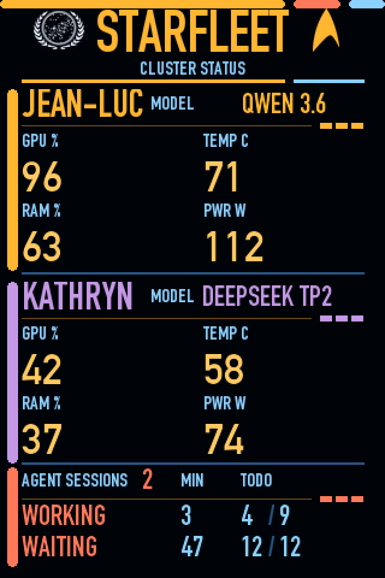
  <br><sub>The panel's dashboard with live figures.</sub>
</p>

<p align="center">
  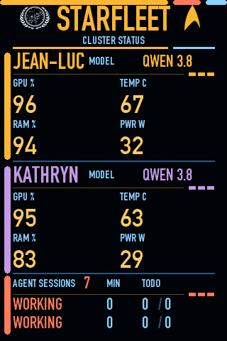
  &nbsp;&nbsp;
  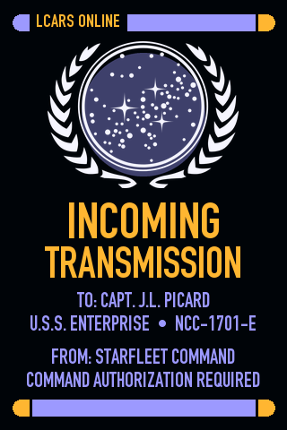
</p>

When no Spark is reachable, or the Mac is locked, it switches to an **"Incoming
Transmission"** screen (which doubles as its loading screen at launch) and comes
back to the dashboard when there is something to show. The switch happens the moment
the Mac locks. GPU figures are streamed about twice a second, and the app pushes to the
panel every 0.5 seconds; everything else feeds off the same pollers as the menu bar.
That stream is the panel's one extra cost: a standing SSH connection and an
`nvidia-smi` loop per node, and only while the panel is on.

The panel blanks its backlight on its own 10 seconds after the app stops sending (sleep,
crash, quit, unplug), and within about a second when the Mac goes to sleep. The
resident model is drawn as two word cells, a brand and a variant (`QWEN` + `3.6`), and
when a node holds several models a TP=2 model wins over a single-node language model,
which wins over embedders and image containers.

It is a USB HID "sensor panel", *not* a display: it stores a compiled theme in flash
and renders locally while the app pushes numbers on 22 channels. Building and flashing
the theme (the protocol, the theme format, what the firmware will and will not do) is
in **[panel-theme/README.md](panel-theme/README.md)**. Once flashed, tick **"Send
to USB panel"** in the dropdown; a brightness slider appears next to it.

---

## Cluster tooling

`cluster/` holds everything the running fleet executes: the closure of what
`config.yaml`, ctxproxy, `fleet.py` and the systemd timers and services invoke.

### Launchers

| Launcher | Serves |
| --- | --- |
| [`serve-vllm-dflash.sh`](cluster/llama-swap/serve-vllm-dflash.sh) | single-node vLLM, a key table in which each key picks its own vLLM image (it began as the DFlash speculative-decoding backend) |
| [`serve-kathryn.sh`](cluster/llama-swap/serve-kathryn.sh), `serve-kathryn-*.sh` | the same on Kathryn: ssh over, her memcheck, `ssh -L` tunnel back |
| [`pick-node.sh`](cluster/llama-swap/pick-node.sh) | the Auto (`-fastest-node`) members |
| [`serve-starfleet.sh`](cluster/llama-swap/serve-starfleet.sh) | TP=2 vLLM across both Sparks (Ray and RoCE), a key table in front of `run-ds4-tp2-cluster.sh` |
| [`serve-sglang.sh`](cluster/llama-swap/serve-sglang.sh) | TP=2 SGLang (Qwen3.8-Flash-Next and GLM), a key table in front of `run-sglang-tp2-cluster.sh` |
| [`serve-ornith-tp2.sh`](cluster/llama-swap/serve-ornith-tp2.sh) | Ornith-1.5-122B (NVFP4) as TP=2 |
| [`serve-nemcascade.sh`](cluster/llama-swap/serve-nemcascade.sh) | Nemotron-Cascade single-node, through `run-single-node.sh` |
| [`serve-embed.sh`](cluster/llama-swap/serve-embed.sh), [`serve-mm-embed.py`](cluster/llama-swap/serve-mm-embed.py) | embedders and rerankers; the multimodal embedder |
| [`ds4-tp2-proxy-guard.sh`](cluster/llama-swap/ds4-tp2-proxy-guard.sh), `ds4/serve-ds4.sh` | DeepSeek-V4-Flash TP=2, and the single-node ds4 engine (whose launcher refuses to start until re-enabled with `~/.ds4-enabled`) |

The key tables exist because llama-swap word-splits the `cmd:` string, so per-model
flag strings with spaces have to live in a script where quoting is under control.

### Services and timers

The user units in [`cluster/systemd/`](cluster/systemd):

| Unit | Does |
| --- | --- |
| `llama-swap.service` | llama-swap with `-watch-config` (repeat its `ExecStart` with the private `-listen` in a drop-in, [The Starfleet key](#the-starfleet-key)) |
| `llama-swap-ctxproxy.service` | ctxproxy, the key gate |
| `fleet-ui.service` | Fleet, after waiting for the tailnet address |
| `reap-orphan-sglang.timer` | the orphan reaper, every 5 minutes |
| `glm-memfloor.service` | the GLM memory floor |
| `kathryn-sync.timer` | the hourly mirror to Kathryn |

[`kathryn-sync.sh`](cluster/kathryn-sync.sh) mirrors `~/llama-swap`, `~/ds4`,
`~/Speech-to-Image`, `~/models` and `~/comfyui-data` from Jean-Luc, the source of
truth, to Kathryn every hour with `--delete`. `gpujob-run` is
copied first, and the full mirror is skipped while a model download is in flight.

### Keeping the repo and the nodes in step

[`cluster/MANIFEST`](cluster/MANIFEST) lists every deployed file with its repo path,
host path and nodes, and says what is deliberately left out (the llama-swap binary,
benchmark one-offs, run logs, obsolete launchers, and the private notifier).
[`cluster/sync-hosts.sh`](cluster/sync-hosts.sh) runs on the Mac:

```bash
./cluster/sync-hosts.sh check      # what differs, file by file and node by node
./cluster/sync-hosts.sh pull       # host -> repo, to take edits made on a node
./cluster/sync-hosts.sh push       # repo -> hosts, backing each host file up first (.bak-sync-<ts>)
./cluster/sync-hosts.sh selftest   # the conflict rules, against fixed cases
```

Its conflict guard is a three-way comparison against the version last synced with
each node (recorded in `.git/sync-hosts.state`), not against `HEAD`: **REPO AHEAD**
(push deploys it), **HOST EDITED** (pull takes it) or **DIVERGED** (resolve by hand,
then `--force`).

### opencode integration

- [`opencode-sync-model-limits.py`](cluster/opencode-sync-model-limits.py) writes each
  model's real context and output limits, traced to its launcher (or the context set in
  `~/.gb10/ctx/<member>`), into `opencode.json`.
- [`merge-system-llamaswap.mjs`](cluster/opencode/merge-system-llamaswap.mjs), an
  opencode plugin, joins several system messages into one for the llama-swap provider,
  because Qwen3.8-Flash-Next's chat template rejects a second one.

---

## Setting it up for your own cluster

### 1. On each node

Both scripts are in [`cluster/`](cluster). Copy them to every node:

```bash
scp cluster/opencode-status.py cluster/opencode-export-tail.py <node>:~/bin/ && ssh <node> 'chmod +x ~/bin/opencode-status.py ~/bin/opencode-export-tail.py'
```

`opencode-status.py` emits one JSON blob: host stats (RAM, GPU load, temp,
power), the models `llama-swap` reports as running, and every recent
Claude Code + opencode session with its state. `opencode-export-tail.py` returns
the last few messages of a session, for the expandable rows in the dropdown.

Neither needs the cluster to be running: a node with no GPU jobs just reports
idle, and an unreachable `llama-swap` is silently omitted rather than erroring.

### 2. Passwordless SSH

Confirm it works exactly as the app will call it, for every node:

```bash
ssh -o BatchMode=yes <node> '~/bin/opencode-status.py'
```

That must print JSON with no prompt. If it prompts, load your key into the agent
(`ssh-add --apple-use-keychain ~/.ssh/<key>`) or set `UseKeychain yes`.

### 3. SSH connection reuse

The app polls every 2 seconds. Without a shared control connection that's a
fresh TCP + auth handshake each time. Add per node to `~/.ssh/config`:

```
Host jean-luc
  Hostname jean-luc.<your-tailnet>.ts.net
  ControlMaster auto
  ControlPersist 60s
  ControlPath ~/.ssh/cm-%r@%h:%p
```

**Warning: use the Tailscale MagicDNS FQDN, never a pinned `100.x` IP.** A pinned IP
goes stale whenever Tailscale reassigns an address; this broke both nodes at
once, live, right after switching networks. A bare unqualified short name isn't
safe either: it races your router's mDNS answer for the same name.

### 4. Point the app at your nodes

Hosts are instantiated in [`Sources/OpencodeMonitor/App.swift`](Sources/OpencodeMonitor/App.swift):

```swift
let jeanLuc = StatusPoller(host: "jean-luc", label: "Jean-Luc")
let kathryn = StatusPoller(host: "kathryn", label: "Kathryn")
```

`host:` is the SSH alias, `label:` is the display name. Two nodes are hardcoded
deliberately: see [Known limits](docs/menu-bar-app.md#notes--known-limits).

### 5. Build

```bash
./package.sh
```

Produces `Starfleet Command.app` (release build, ad-hoc signed). Open it, or drag
it to `/Applications`. Use the `.app` rather than `swift run`: notifications and
"Launch at Login" both need a real bundle identity. The ad-hoc signature changes with
every build, so macOS may ask for the microphone again after a rebuild.

Needs Xcode in `/Applications`, not only the Command Line Tools: from the macOS 27 SDK
on, SwiftUI's `@State` is a macro whose plugin ships with Xcode alone. The app itself
needs macOS 15 or later, for the Fleet window's own full screen. `package.sh`
switches to Xcode for the build when the Command Line Tools are the selected developer
directory; set `DEVELOPER_DIR` yourself for an Xcode installed elsewhere.

### 6. The iPhone app

In [`ios/`](ios): an Xcode project, `ios/Starfleet.xcodeproj`, with the SwiftUI app
(`ios/Starfleet/StarfleetApp.swift`: the web view and the bridge to the page), its push code
(`ios/Starfleet/Push.swift` and `ios/Starfleet/PushText.swift`: notification permission, the
device token, a tap on a notification, the icon badge), the entitlements file
`ios/Starfleet.entitlements` (see **Push messages** below) and the app icon. Needs Xcode 16 or later, an iPhone with the Tailscale app on the same
tailnet, and an Apple ID; a free one works, but its "Personal Team" signature expires
after 7 days, then build and install again.

1. Open `ios/Starfleet.xcodeproj` in Xcode.
2. Target **Starfleet** → **Signing & Capabilities** → **Team**: pick yours. If the
   bundle ID is taken, change it there to your own reverse domain.
3. Connect the iPhone by cable and trust the Mac. First time only: on the iPhone,
   **Settings → Privacy & Security → Developer Mode** on, restart.
4. Choose the iPhone as the run destination and press `⌘R`. With a free team, the first
   start needs **Settings → General → VPN & Device Management** → trust your developer
   profile.
5. In the app, enter Fleet's HTTPS address and tap **Connect**.

Picking the team writes your Team ID into `project.pbxproj`. To keep it out of git, move
it into the gitignored `ios/Local.xcconfig`, which `ios/Starfleet.xcconfig` includes:

```bash
cd ios && grep -m1 -o 'DEVELOPMENT_TEAM = [A-Z0-9]*' Starfleet.xcodeproj/project.pbxproj > Local.xcconfig && git checkout Starfleet.xcodeproj/project.pbxproj
```

**Push messages** need the paid Apple Developer Program (99 US dollars a year): a free Apple ID cannot sign an app with the Push capability. Being self-employed makes no difference there. A freelancer or other sole proprietor enrolls as an **individual** and needs no company number; the D-U-N-S number (a company identifier from Dun & Bradstreet) is only asked of organizations. Until then the app builds and runs as above. After a tap on **Turn on push** on the Messages screen (and the answer to the system's question about notifications), the Messages screen says that push needs the paid membership.

`ios/Starfleet.entitlements` asks for push. A free team cannot sign it, so the project file and `ios/Starfleet.xcconfig` do not point to it. Two settings in the gitignored `ios/Local.xcconfig` and one build by hand decide whether a build with push happens:

1. Set `DEVELOPMENT_TEAM` to the ID of the paid team (developer.apple.com, **Membership details**).
2. **Append** the line `CODE_SIGN_ENTITLEMENTS = Starfleet.entitlements`, for example with `echo 'CODE_SIGN_ENTITLEMENTS = Starfleet.entitlements' >> ios/Local.xcconfig`. Do not overwrite the file: the `>` in the command above replaces everything in it, the team line included.
3. Build once by hand: choose the iPhone in Xcode and press `⌘R`. Xcode, signed in with the paid team, enables the Push capability for the app by itself. `update.sh` does not do this step for you: it only builds when something under `ios/` changed in git, and `ios/Local.xcconfig` is not in git, so editing it starts no build.

Then tap **Turn on push** on the Messages screen. To go back to a free team, remove the `CODE_SIGN_ENTITLEMENTS` line and set the free team's ID again.

### Updates, at every start of the Mac app

Build and install by hand once; after that the Mac app updates both apps itself. At
every start, and from **Check for Updates…** in the dropdown or the app menu, it runs
[`update.sh`](update.sh) from the clone it was built from (`package.sh` stamps that path
and the commit into the bundle), in the background:

1. `main` is fast-forwarded from `origin`. Never a merge; a clone on another branch, or
   with local commits, is left alone.
2. **Mac**: when the app's sources changed since the running build, `package.sh`
   rebuilds it, and the app quits, is swapped for the new bundle and opens again. The
   swap (renames only) happens before the app quits, so a folder it cannot be written
   to, or a failed build, leaves the running app alone. Uncommitted changes
   in the app's sources are not built: the stamp would pass them off as the commit.
3. **iPhone**, once the Mac app is current (after a Mac update, the new app's own start
   does this): when `ios/` changed since the last install, the app is built with
   `xcodebuild` and installed with `devicectl` on the paired iPhone that is on the cable
   or the same Wi-Fi now. An iOS app cannot replace itself, so the Mac does it. Needs
   `ios/Local.xcconfig` (see above) and the iPhone paired with Xcode once. With a free
   Apple ID the signature lasts 7 days: once the installed build's profile has expired,
   it is signed and installed again without a change in `ios/`.

One run at a time per clone, also when the app is quit and opened again during a build: a
lock (`shlock`) that is dropped once its process is gone, and the update quits a copy
opened again meanwhile too. The dropdown shows how the last run ended:

- up to date, with the build's commit;
- GitHub not reachable;
- the clone is on another branch, cannot fast-forward, or has uncommitted changes in the
  app's sources;
- the iPhone app was not updated (phone away, or its build failed);
- another update is still running;
- a failure.

All but "up to date" and "another update" come with a **Log** button. A run that finds a
new Mac build ends with the app restarting.

The page itself needs none of this: Fleet serves it fresh. The log is
`~/Library/Logs/Starfleet Command update.log`. The first signed `xcodebuild` may ask once
for keychain access to your signing key: Always Allow. Whatever is on `main` gets built
and run at the next start, so only push there what you would run.

### 7. Fleet and the cluster tooling

Fleet runs on the head node: see [Setup](#setup). The llama-swap config, launchers,
guards and units go to the nodes with `sync-hosts.sh`: see
[Cluster tooling](#cluster-tooling).

### 8. Optional: the USB panel

Not needed for anything above: see [Add-on: the USB panel](#add-on-a-usb-panel-for-the-desk).

---

## Repo layout

```
Sources/OpencodeMonitor/   the app (the directory keeps the project's original name)
  App.swift                 entry point; where the nodes are declared, MenuBarExtra + Fleet's Window scene,
                            the self-update and Check for Updates
  HelpAbout.swift           the Help window's text and the About panel
  StatusPoller.swift        SSH polling, stall detection, Tailscale re-auth
  Models.swift              payload decoding + session ordering
  ContentView.swift         menu bar dropdown
  FleetView.swift           the Fleet window (WKWebView), its Dock-icon-on-demand logic, the ⌃⌥C hotkey
  DesktopWidget*.swift      floating panel
  Panel*.swift, GPUStream.swift   the optional USB panel: driver, controller, streamed GPU figures
ios/                       the iPhone app: Starfleet.xcodeproj, Starfleet/StarfleetApp.swift (the web view and PaddBridge),
                            Starfleet/Push.swift and PushText.swift (notifications), Starfleet.entitlements (push, not
                            used by the build until Local.xcconfig points to it), the icon
package.sh, update.sh      build the Mac app; the self-update both apps get at every start of the Mac app
                            and from Check for Updates
cluster/                   the cluster's configuration and tooling: the llama-swap config and
                            launchers, the memory guard (memcheck.sh and friends), the context proxy
                            that also gates every load, the status scripts the app runs over ssh,
                            and sync-hosts.sh to keep this repo and the nodes in step
  MANIFEST                  what is deployed where
  llama-swap/               config.yaml, ctxproxy.py, launchers and guards
  systemd/                  the user units and timers
  opencode/                 the opencode plugin
  ds4/                      the single-node ds4 launcher
fleet-ui/                  Fleet's backend: fleet.py, wikicore.py, fleet.html and the phone interface
                            padd.html (vendor/ holds the pages' scripts and styles, test/ the phone
                            interface's WebKit tests), copied to the head node
                            (fleet-ui/sounds/ holds your own Red Alert clip and fleet-ui/ds9.jpg an
                            optional NAS backdrop; both stay out of git)
docs/images/               screenshots of the Fleet views and the USB panel
docs/menu-bar-app.md       deep-dive on the monitoring surfaces and their known limits
panel-theme/               offline tooling for the optional USB panel's theme
assets/                    icon + brand mark generators
```

---

## Licence and attribution

MIT: see [LICENSE](LICENSE).

The USB panel protocol was transcribed from **James Buren's `hidss`**
([gitlab.com/braewoods/usb-smart-screen](https://gitlab.com/braewoods/usb-smart-screen),
branch `hidss`, MIT). Both it and the Python
[`smartmonitor_hid_lib`](https://github.com/Agentry433/smartmonitor_hid_lib) are
Linux-only; the macOS transports here are original ports.

`smartmonitor_hid_lib` is **GPL-3.0** and is therefore *not* vendored into this
MIT repo: `panel-theme/README.md` has the clone commands, and it is only needed
to *rebuild* the theme, never at runtime. The shipped `PanelDriver.swift` derives
from the MIT C reference, so the app itself carries no GPL obligation.

Artwork provenance is documented in `panel-theme/README.md`. The Starfleet delta
is transcribed from the [Commons delta-shield](https://commons.wikimedia.org/wiki/File:Delta-shield.svg);
the Federation emblem is from
[Commons](https://commons.wikimedia.org/wiki/File:United_Federation_of_Planets_Flag.svg)
(public domain).

Star Trek and its iconography are trademarks of Paramount. This is a personal,
non-commercial hobby project with no affiliation.
