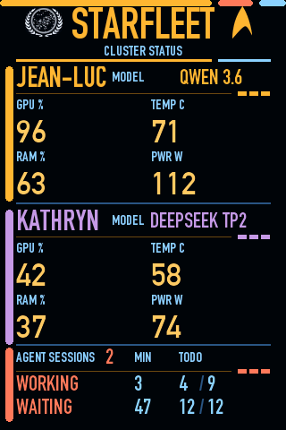
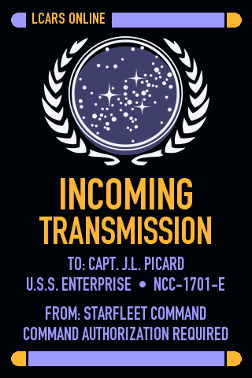

# Starfleet Command

A macOS app for running a small home cluster of GPU machines as one LLM service.
It lets you decide which models stay resident, on which machine, at what context
size and with what thinking effort — and the cluster tooling behind it **refuses a
load the machine cannot hold** instead of letting it OOM. While it does that it
keeps an eye on the cluster: a menu bar glyph, a floating desktop widget and, if
you build one, a small USB panel on the desk.

It is built around two NVIDIA DGX Spark nodes, **Jean-Luc** and **Kathryn** — so the
fleet is Starfleet — with [llama-swap](https://github.com/mostlygeek/llama-swap) in
front of 39 models and **Fleet**, a window in the app, as the control surface.

```
  Mac                                           Spark nodes
  ┌──────────────────────────────┐             ┌───────────────────────────────────┐
  │ Starfleet Command.app        │   HTTP      │ Jean-Luc (head)                   │
  │   Fleet window ──────────────┼────────────▶│   fleet-ui ─▶ llama-swap          │
  │                              │             │                 ├─ memcheck       │
  │   menu bar · desktop widget  │    ssh      │                 └─ ctxproxy       │
  │   (+ optional USB panel)  ───┼────────────▶│ Kathryn (worker)                  │
  └──────────────────────────────┘             └───────────────────────────────────┘
```

---

## What it does

- **Manages the models.** Search the catalogue, pin a model so it stays resident,
  choose which machine it runs on, set its context size and thinking effort, watch a
  load's progress and cancel it. → [Fleet](#fleet--managing-the-models-from-a-window)
- **Protects the machines.** Every load goes through a memory check that knows what
  is free *and* what is already promised to a running image or video job, reaps
  orphaned tensor-parallel clusters, and refuses cleanly rather than OOMing.
  → [The memory guard](#the-memory-guard--admission-control-before-every-load)
- **Keeps the configuration honest.** The cluster's llama-swap config, launchers and
  guards live in this repo (`cluster/`), with a sync tool that compares them with the
  nodes before it overwrites anything. → [Repo layout](#repo-layout)
- **Watches the cluster.** GPU load, temperature, power and memory per node, which
  models are resident, and which coding-agent sessions are running — in the menu bar
  and on a desktop widget, with a notification when a session stalls.
  → [Watching the cluster](#watching-the-cluster)
- **Add-on: a USB panel for the desk.** A little LCARS readout, entirely optional.
  → [Add-on: the USB panel](#add-on-a-usb-panel-for-the-desk)

---

## The Starfleet cluster

Two **NVIDIA DGX Spark** nodes, each a GB10 with ~121 GiB of unified memory and
20 CPU cores, on the same LAN and reachable over Tailscale:

| Node | Role |
| --- | --- |
| **Jean-Luc** | Head node. Runs [llama-swap](https://github.com/mostlygeek/llama-swap), which fronts every model behind a single OpenAI-compatible endpoint. |
| **Kathryn** | Worker. Serves models of her own, and pairs with Jean-Luc for tensor-parallel jobs. |

### llama-swap holds the fleet together

**[llama-swap](https://github.com/mostlygeek/llama-swap)** (by
[mostlygeek](https://github.com/mostlygeek)) is the piece that makes a
two-machine fleet usable. It's a lightweight proxy that sits in front of your
inference servers and **swaps models in and out on demand**: a request names a
model, llama-swap starts whatever process serves it, proxies the request, and
unloads it again after an idle TTL.

That matters here because 39 models are defined but only ~121 GiB per node is
available. Without it you'd be manually starting and stopping vLLM. With it,
everything — the coding agents, this monitor, any OpenAI-compatible client —
talks to **one endpoint on the head node** and never thinks about placement.

Three features do the heavy lifting for a cluster:

- **Groups with swap/exclusive semantics.** Small models are marked to
  co-reside; a huge one is exclusive and evicts everything else on load. Crucially,
  Kathryn's pool is `exclusive: false` — loading a model on *her* machine frees
  nothing on *his*, so the two pools must never evict each other. Getting that
  wrong is how you end up with a node thrashing.
- **Arbitrary launch commands.** A "model" is just a command line, so a member
  can be a local vLLM, an SSH into Kathryn that starts a server there and tunnels
  the port back, or a Ray cluster spanning both Sparks for TP=2. All three look
  identical to the client.
- **Health checks and TTLs.** `checkEndpoint` gates readiness (a big model can
  take minutes to load), and `ttl` reclaims memory from idle models automatically.

`/running` on the head node reports what's currently resident — which is exactly
what the monitor's "Serving:" line reads.

Models are named for what they are and where they run:

```
gemma4-26b-54tps-jean-luc     pinned to the head node
gemma4-26b-57tps-kathryn      pinned to the worker
gemma4-31b-19tps-starfleet    tensor-parallel across BOTH
```

The embedded tok/s figure is the measured single-stream throughput of that exact
configuration, so the fastest option is obvious from the name alone.

### Not every member is a chat model

Twelve of the 39 never generate a token. Six are embedders — `nomic-embed-text`,
`embeddinggemma`, `harrier-embed-0.6b` — and six are rerankers — the
`bge-reranker-v2-m3` cross-encoder and `qwen3-reranker-4b`/`-8b` — each with a
twin on the other node. All twelve are served by
[`serve-embed.sh`](cluster/llama-swap/serve-embed.sh) through vLLM's pooling
runner, in two groups that both set `swap: false` and `exclusive: false`: a
retrieval call must never evict a language model, and must never be evicted by
one. They are separate groups because retrieval usually wants an embedder and a
reranker resident at the same time.

The twins are not redundancy. Jean-Luc's pool can be genuinely too full for a
1 GiB model while a TP=2 member occupies it — on 2026-09-23 `harrier-embed-0.6b`
died on the head node with *"No available memory for the cache blocks"* while
Qwen3.8-Flash-Next held the pool, and the Kathryn twin served the identical
request without complaint. `gpu-memory-utilization` is a fraction of the whole
pool, not of what is left in it, so a tiny model can still be squeezed out.
Having each embedder addressable on either node is what makes that survivable.

One naming note. Fleet has a filter per kind, and each is a single test against
the member id — `/embed/i` and `/rerank/i`. That only partitions cleanly because
no embedder id contains `rerank` and no reranker id contains `embed`, which is a
convention the member names have to keep rather than something the code can
enforce: `microsoft/harrier-oss-v1-0.6b` is wired as `harrier-embed-0.6b` for
exactly that reason. Choosing the name is free; teaching two filters a list of
exceptions is not.

---

## Fleet — managing the models from a window

**Fleet** is the control surface, and the part of Starfleet Command that does the
work. It is a window inside the app (`FleetView.swift`, a `WKWebView`) around
**[`fleet-ui`](fleet-ui)**, a single-file stdlib-only Python dashboard that runs on
the head node and drives llama-swap. It opens on demand — "Open Starfleet Command…"
in the menu bar dropdown — rather than at launch: the app is normally a menu-bar-only
accessory process with no Dock icon, and becomes a regular app (Dock icon, `⌘`-Tab
entry) only while the Fleet window is open, reverting the moment it closes.

From it you can:

- **Browse the whole catalogue** — search, and filter by node, Starfleet TP2, Auto,
  Resident, Pinned, Vision, Embeddings, Rerankers or Image — with each model's
  measured tok/s.
- **See each node**: RAM, GPU, temperature, power, load and running containers.
- **Pin** a model so it stays resident ([what that guarantees](#what-pin-actually-guarantees)).
- **Choose where a model runs.** A model deployed on more than one machine gets a
  Machine picker — Jean-Luc, Kathryn, or Auto (whichever Spark has the most free
  memory right now) — and pin, context, effort and load all apply to the machine
  picked. TP=2 members span both nodes by definition, so there is nothing to pick.
- **Set the context size** per model. **Max** is the largest context the model can
  really serve — the smaller of the checkpoint's window and the KV pool measured on
  its first load — not merely what the checkpoint declares. vLLM allocates the pool
  at startup, so a change is one cold reload away; there is no live resize. See
  [Context is its own budget](#context-is-its-own-budget).
- **Set thinking effort**, where the model offers it: only the options that
  checkpoint's chat template actually accepts are shown, and a model with no such
  control shows nothing to pick. It takes effect by evicting the model, so it comes
  back with the new default.
- **Watch a load, and cancel it.** Progress is read from the engine's own log, the
  ETA is the median of that model's last five cold loads, and cancelling unpins first
  — otherwise the keepalive would put the model straight back.
- **See how a member is started**: the vision flag reflects what it is *started*
  with, not what the checkpoint could do.
- **Run image models alongside the language models**: the ComfyUI "Image Creation"
  rows have their own node placement, warm-up and unload.

The backend also exposes the GPU job queue (a `pueue` queue and per-node capacity)
at `/api/jobs`.

### What "pin" actually guarantees

llama-swap's own idle `ttl` and swap-group exclusivity (see above) still fully
apply — Fleet doesn't and shouldn't override them, since group exclusivity is
deliberate, memory-driven config (e.g. the `starfleet` group is `swap: true`
because only one TP=2 model can occupy both Sparks at once). Instead, Fleet
treats "pinned" as "bring it straight back the instant it's gone, no matter
why it left":

- A 5-second watchdog checks every pinned model against `/running`. Missing —
  because its ttl lapsed, *or* because a different member of its swap group
  got requested and evicted it — triggers an immediate reload, not a wait for
  the next tick.
- Each reload runs in its own thread. A slow cold load (TP=2 can take 20+
  minutes) no longer blocks refreshing every *other* pin, which is what the
  original single-threaded, one-at-a-time loop did.
- A model that's still resident just gets a periodic ttl-refresh touch
  (`GET /upstream/<model>/health`), well inside the shortest configured ttl.

### Setup

1. Copy `fleet-ui/fleet.py` and `fleet-ui/fleet.html` to the head node and run
   `python3 fleet.py` (binds the Tailscale IP by default so it's reachable
   from your Mac but not the LAN; see `default_host()`). A systemd user unit
   works well for keeping it up across reboots.
2. Point [`Sources/OpencodeMonitor/FleetView.swift`](Sources/OpencodeMonitor/FleetView.swift)'s
   `fleetURL` and [`Sources/OpencodeMonitor/Info.plist`](Sources/OpencodeMonitor/Info.plist)'s
   `NSExceptionDomains` entry at your own head node's address — fleet-ui serves
   plain HTTP, so that ATS exception is what lets `WKWebView` load it.
3. Build with `./package.sh`, same as the rest of the app (see below) — Fleet
   ships inside `Starfleet Command.app`, not as its own bundle.

---

## The memory guard — admission control before every load

The most important thing the cluster tooling does is **say no**. Thirty-nine models
share ~121 GiB per node, and the failure mode of an unguarded load is an OOM kill
mid-load, taking whatever else was resident with it. So every load passes a
preflight gate first, and the guard rails around it were earned by real incidents,
described below.

llama-swap has no built-in idea how much memory a host actually has free before
starting a model — there's an open ask for exactly that
([mostlygeek/llama-swap#158](https://github.com/mostlygeek/llama-swap/issues/158)),
closed `not_planned`. With 39 models sharing ~121 GiB per node, an unguarded
`cmd:` means the failure mode is an OOM kill mid-load, not a clean refusal.

Every member's `cmd:` in [`config.yaml`](cluster/llama-swap/config.yaml) runs
through [`memcheck.sh`](cluster/llama-swap/memcheck.sh) first — a pure
preflight gate, read-only, that never evicts anything:

```
MemAvailable - live_reservations  >=  need_mb
```

`live_reservations` reads a ledger shared with the image/video generation
pipeline, so an LLM load and a ComfyUI render never blind-collide for the same
unified memory pool. Two more things it does before that arithmetic, both
earned by real incidents: drops page cache before a big load (`MemAvailable`
counts reclaimable cache that a large burst allocation can't reclaim fast
enough on its own — this caused two OOMs while the check reported 114 GiB
free), and reaps orphaned two-node TP clusters (`ds4-tp2`, `sglang-tp2`) that
survive their own teardown trap and silently strand ~90–100 GiB each,
otherwise invisible to everything else. The orphan check requires two
independent signals to agree — llama-swap's own `/running` list *and* a
launcher-pid ownership label on the container — because a fully healthy,
fully responsive orphan once held memory for two hours before this existed.

The `ds4-nvfp4-tp2` member (a two-Spark Ray cluster, not a single process)
adds [`ds4-tp2-proxy-guard.sh`](cluster/llama-swap/ds4-tp2-proxy-guard.sh) on
top: a liveness probe decides whether to launch the cluster (llama-swap owns
it, tears it down on evict) or park with `sleep infinity` and proxy to a
cluster already running outside llama-swap's control (started by hand or a
systemd unit) — so llama-swap never thinks it owns something it didn't start.

Full write-up, incident-by-incident: see the source comments in
[`memcheck.sh`](cluster/llama-swap/memcheck.sh) and
[`ds4-tp2-proxy-guard.sh`](cluster/llama-swap/ds4-tp2-proxy-guard.sh).

---

## Context is its own budget

Fitting the weights is only half of it. A long context is bought with KV cache,
and on a fixed pool that trade has to be made explicitly.

Some of it is not a memory question at all. Qwen3.8-Flash-Next stops at 262,144
tokens because of a **positional** wall, not a memory one — at mem-fraction 0.80
its KV pool already holds ~690k tokens, so 512k costs nothing extra. A YaRN
factor-2.0 rope override doubles the window, and that is the whole difference
between `qwen38fn-sglang-tp2-starfleet` and its `-long` sibling. Measured at
479,655 prompt tokens (1.83× native): needles at depths 0.10/0.50/0.90 recalled
3/3 exactly. The cost is speed, not capacity — ~23.7 tok/s against the 262k
member's 48.9. Roughly half, which is precisely why both members exist rather
than one.

GLM-5.3-Flash is the opposite case: there the context genuinely is a memory
budget, and three hardcoded numbers (`NEED`, `MEMFRAC`, `CTX`) kept disagreeing
with each other and with the machine. [`glm-size.py`](cluster/llama-swap/glm-size.py)
replaces them — given the context actually being requested it returns the
mem-fraction, the admission requirement, and `--max-total-tokens`, all three
derived from one model of the pool. That last flag is not optional: left to
itself SGLang once sized a KV cache of 1,182,720 tokens for a 32k member.

Per-member context lives in `~/.gb10/ctx/<member>`, so a window can be changed
without editing `config.yaml` — which matters more than it sounds, because
writing that file triggers llama-swap's `-watch-config` reload and evicts every
resident model, and a cold TP=2 load runs 26–41 minutes.

---

## Why tensor parallelism matters here

**Tensor parallelism (TP)** splits each layer's weight matrices across GPUs.
Every node holds a *slice* of every layer, computes its share, and the partial
results are combined with an all-reduce before the next layer. Contrast with
pipeline parallelism, which gives each node whole *layers* — TP keeps both nodes
busy on every token, at the cost of a network round-trip per layer.

For a two-Spark fleet that buys two distinct things.

### 1. Capacity — models that simply don't fit otherwise

One Spark has ~121 GiB. TP=2 pools both, so the ceiling roughly doubles:

| Model | Size on disk | Fits one node? |
| --- | --- | --- |
| Qwen3-235B-A22B | 124.9 GiB | ✗ — TP=2 only |
| DeepSeek-V4-Flash | 156.7 GiB | ✗ — TP=2 only |
| HunYuan hy_v3 | 168.4 GiB | ✗ — TP=2 only |
| Qwen3.5-397B-A17B | 226.8 GiB | ✗ — TP=2, and only just |

That last one is a 400B-class model running on two desktop boxes at 12.3 tok/s,
with 2–4 GiB of headroom to spare. Without TP it is simply not servable.

### 2. Throughput under load — not single-stream latency

This is the part that surprises people. gemma-4-26B-A4B, measured both ways:

| gemma-4-26B-A4B | Single node | TP=2 |
| --- | --- | --- |
| Single stream | 46.2 tok/s | 48.2 tok/s **(+4%)** |
| Aggregate @16 concurrent | 331.7 tok/s | 453.8 tok/s **(+37%)** |

If you only ever watch one reply stream, TP=2 is nearly pointless here — two
extra tok/s for the cost of occupying *both* Sparks. Serve sixteen concurrent
requests and the same configuration is worth 37%.

So the model stays wired all four ways — pinned to either node, "whichever node
has more free memory right now", and TP=2 — and you pick by workload rather
than assuming the parallel version is simply better.

### 3. …and sometimes one Spark is the right answer

Two models are served single-node **only** — there is no `-starfleet` member for
either, for quite different reasons:

| Model | tok/s | Why one node |
| --- | --- | --- |
| Qwen3.6-35B-A3B | **57.1** | Sparse MoE, ~3B active — measured *faster* single than TP=2 |
| Qwen3.8-27B | ~14 | Memory-bandwidth-bound, not compute-bound |

**Qwen3.6-35B** is the fastest thing on the fleet, and it gets there by staying
on one box. A sparse MoE that activates only ~3B parameters per token does very
little work per layer — so there is almost nothing for TP to split, while the
cross-node all-reduce still fires on **every layer of every token**.
Communication dominates and TP=2 comes out slower.

**Qwen3.8-27B** is limited by something TP doesn't address at all. Each decode
step reads 15.13 GiB of weights (12.76 GiB body + 2.37 GiB BF16 `lm_head`), and
against the GB10's 273 GB/s that puts the roofline at ~16.8 tok/s. The measured
~14 is close to that ceiling, so the win is quantising `lm_head` to NVFP4 —
worth ~2 GiB/step and a lift to ~19.5 — not adding nodes. Being bandwidth-bound
also makes batching nearly free, which is why it's better to point many
concurrent requests at one endpoint than to serialise them.

The rule of thumb: **TP pays when per-layer compute is large relative to
interconnect latency.** Active parameter count predicts that far better than
total model size — and if the bottleneck is memory bandwidth, more nodes is the
wrong lever entirely.

Two corollaries:

- **The interconnect is the whole ballgame.** These nodes talk over RoCE (RDMA
  over Converged Ethernet). On a slower link the break-even point moves sharply
  toward larger models.
- **Benchmark, don't assume.** Every model in the roster is pinned to whichever
  mode actually measured faster — which is why some `-starfleet` members exist
  and some models are deliberately single-node.

---

## Watching the cluster

Starfleet Command also watches the cluster, read-only, over SSH: GPU load,
temperature, power and memory per node, which models `llama-swap` currently has
resident, and which coding-agent sessions (Claude Code and opencode) are running and
what state they are in.

| Surface | What it is |
| --- | --- |
| **Menu bar** | An always-visible health glyph with a `⚡N` count of actively-generating sessions. Click for the full per-host breakdown, expandable session transcripts and settings. A notification fires when a session stalls. |
| **Desktop widget** | A borderless always-on-top panel with the same live data, for when you want it visible without clicking. Drag anywhere; position persists. |

Both share one set of `StatusPoller`s, so adding a surface adds **no** polling load
on the cluster. The details, and the known limits, are in
[`docs/menu-bar-app.md`](docs/menu-bar-app.md).

---

## Add-on: a USB panel for the desk

Nothing above needs it — it is a toy, and a good one. A 3.5″ 320×480 USB panel
(`0483:0065`) sits on the desk and shows the cluster in LCARS styling: per-node GPU
load, temperature, RAM and power; the model resident on each node (`QWEN 3.8`,
`DEEPSEEK TP2`, …); and the two most recently active agent sessions.

<p align="center">
  
  &nbsp;&nbsp;
  
</p>

When no Spark is reachable, or the Mac is locked, it switches to an **"Incoming
Transmission"** screen — which doubles as its loading screen at launch — and comes
back to the dashboard when there is something to show. GPU figures are streamed about
twice a second; everything else feeds off the same pollers as the menu bar. That
stream is the panel's one extra cost: a standing SSH connection and an `nvidia-smi`
loop per node, and only while the panel is on.

It is a USB HID "sensor panel", *not* a display: it stores a compiled theme in flash
and renders locally while the app pushes numbers on 22 channels. Building and flashing
the theme — the protocol, the theme format, what the firmware will and will not do —
is in **[panel-theme/README.md](panel-theme/README.md)**. Once flashed, tick **"Send
to USB panel"** in the dropdown; a brightness slider appears next to it.

---

## Setting it up for your own cluster

### 1. On each node

Both scripts are in [`cluster/`](cluster). Copy them to every node:

```bash
scp cluster/opencode-status.py cluster/opencode-export-tail.py <node>:~/bin/ && ssh <node> 'chmod +x ~/bin/opencode-status.py ~/bin/opencode-export-tail.py'
```

`opencode-status.py` emits one JSON blob: host stats (RAM, GPU load, temp,
power), the models `llama-swap` reports as running, and every recent
Claude Code + opencode session with its state. `opencode-export-tail.py` returns
the last few messages of a session, for the expandable rows in the dropdown.

Neither needs the cluster to be running — a node with no GPU jobs just reports
idle, and an unreachable `llama-swap` is silently omitted rather than erroring.

### 2. Passwordless SSH

Confirm it works exactly as the app will call it, for every node:

```bash
ssh -o BatchMode=yes <node> '~/bin/opencode-status.py'
```

That must print JSON with no prompt. If it prompts, load your key into the agent
(`ssh-add --apple-use-keychain ~/.ssh/<key>`) or set `UseKeychain yes`.

### 3. SSH connection reuse

The app polls every 2 seconds. Without a shared control connection that's a
fresh TCP + auth handshake each time. Add per node to `~/.ssh/config`:

```
Host jean-luc
  Hostname jean-luc.<your-tailnet>.ts.net
  ControlMaster auto
  ControlPersist 60s
  ControlPath ~/.ssh/cm-%r@%h:%p
```

⚠️ **Use the Tailscale MagicDNS FQDN, never a pinned `100.x` IP.** A pinned IP
goes stale whenever Tailscale reassigns an address — this broke both nodes at
once, live, right after switching networks. A bare unqualified short name isn't
safe either: it races your router's mDNS answer for the same name.

### 4. Point the app at your nodes

Hosts are instantiated in [`Sources/OpencodeMonitor/App.swift`](Sources/OpencodeMonitor/App.swift):

```swift
let jeanLuc = StatusPoller(host: "jean-luc", label: "Jean-Luc")
let kathryn = StatusPoller(host: "kathryn", label: "Kathryn")
```

`host:` is the SSH alias, `label:` is the display name. Two nodes are hardcoded
deliberately — see [Known limits](docs/menu-bar-app.md#notes--known-limits).

### 5. Build

```bash
./package.sh
```

Produces `Starfleet Command.app` (release build, ad-hoc signed). Open it, or drag
it to `/Applications`. Use the `.app` rather than `swift run` — notifications and
"Launch at Login" both need a real bundle identity.

### 6. Optional: the USB panel

Not needed for anything above — see [Add-on: the USB panel](#add-on-a-usb-panel-for-the-desk).

---

## Repo layout

```
Sources/OpencodeMonitor/   the app
  App.swift                 entry point; where the nodes are declared, MenuBarExtra + Fleet's Window scene
  StatusPoller.swift        SSH polling, stall detection, Tailscale re-auth
  Models.swift              payload decoding + session ordering
  ContentView.swift         menu bar dropdown
  FleetView.swift           the Fleet window (WKWebView) + its Dock-icon-on-demand logic
  DesktopWidget*.swift      floating panel
  Panel*.swift, GPUStream.swift   the optional USB panel: driver, controller, streamed GPU figures
cluster/                   the cluster's configuration and tooling: the llama-swap config and
                            launchers, the memory guard (memcheck.sh and friends), the per-request
                            context proxy, the status scripts the app runs over ssh, and
                            sync-hosts.sh to keep this repo and the nodes in step
fleet-ui/                  Fleet's backend: fleet.py + fleet.html, copied to the head node
docs/menu-bar-app.md       deep-dive on the monitoring surfaces and their known limits
panel-theme/               offline tooling for the optional USB panel's theme
assets/                    icon + brand mark generators
```

---

## Licence and attribution

MIT — see [LICENSE](LICENSE).

The USB panel protocol was transcribed from **James Buren's `hidss`**
([gitlab.com/braewoods/usb-smart-screen](https://gitlab.com/braewoods/usb-smart-screen),
branch `hidss`, MIT). Both it and the Python
[`smartmonitor_hid_lib`](https://github.com/Agentry433/smartmonitor_hid_lib) are
Linux-only; the macOS transports here are original ports.

`smartmonitor_hid_lib` is **GPL-3.0** and is therefore *not* vendored into this
MIT repo — `panel-theme/README.md` has the clone commands, and it is only needed
to *rebuild* the theme, never at runtime. The shipped `PanelDriver.swift` derives
from the MIT C reference, so the app itself carries no GPL obligation.

Artwork provenance is documented in `panel-theme/README.md`. The Starfleet delta
is transcribed from the [Commons delta-shield](https://commons.wikimedia.org/wiki/File:Delta-shield.svg);
the Federation emblem is from
[Commons](https://commons.wikimedia.org/wiki/File:United_Federation_of_Planets_Flag.svg)
(public domain).

Star Trek and its iconography are trademarks of Paramount. This is a personal,
non-commercial hobby project with no affiliation.
